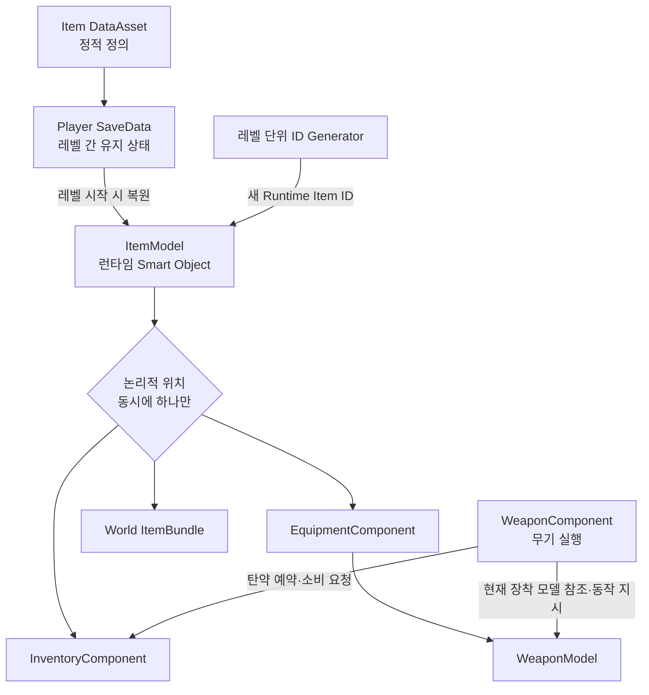
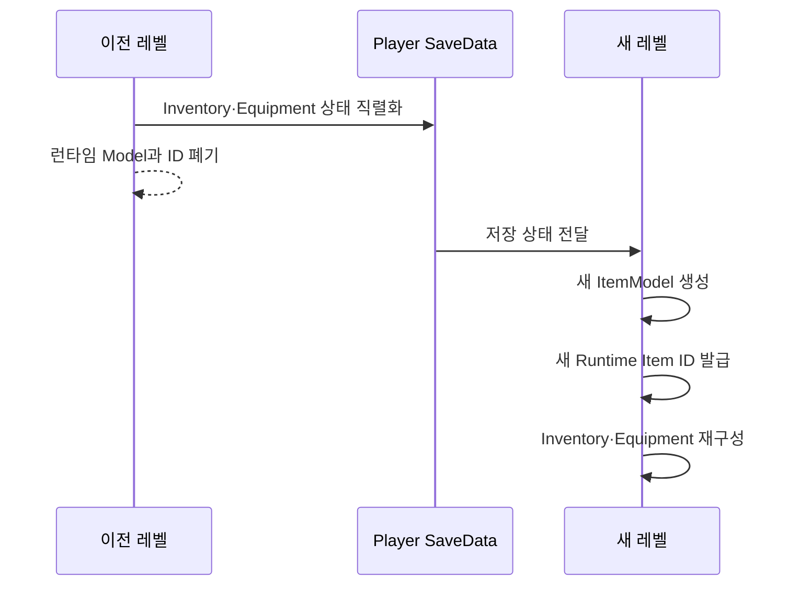
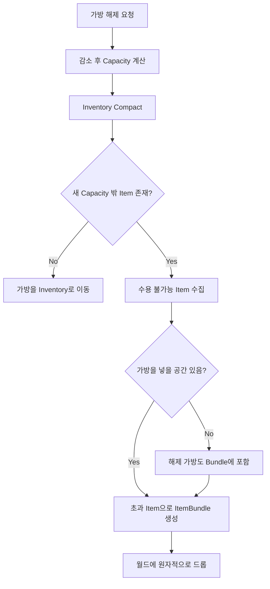

# 장비와 인벤토리



## 상태

| 항목 | 상태 | 비고 |
|---|---|---|
| Item·Equipment·Inventory 책임 | 설계 확정 | 구현 전 |
| Inventory 슬롯·Capacity | 설계 확정 | 최대 49, 기본 21 |
| 장비 획득·교체·해제 | 설계 확정 | 원자적 이동 필요 |
| 탄약 Reservation | 설계 확정 | Stack과 분리 |
| Runtime Item ID | 설계 확정 | 레벨 경계에서 재발급 |
| ID Generator 구현 위치 | 미정 | GameState·Subsystem 등 수명주기 검토 필요 |
| 선호·Reserved 탄 UI 표현 | 일부 미정 | 대표 Stack과 표시 방식 추후 결정 |

## 기본 원칙

Item은 플레이어 또는 다른 Entity가 획득·소유·보관·이전할 수 있는 객체다. 하나의 ItemModel은 동시에 `World`, `Inventory`, `Equipment`, `ItemBundle`, 다른 Entity 중 한 장소에만 존재한다. UI는 Model을 소유하거나 직접 수정하지 않고 요청과 표시만 담당한다.

```text
DataAsset = Item 종류의 정적 정의
ItemModel = 현재 레벨에 존재하는 런타임 상태와 자기 상태 규칙
SaveData = 플레이어가 레벨을 넘어 유지해야 하는 직렬화 데이터
```

Model은 단순 데이터 구조가 아니라 자기 상태를 판단하는 Smart Object다. 예를 들어 WeaponModel은 `CanFire`, `CanReload`, `CanUseAmmo`, 내구도 변경과 등록 탄약 상태를 판단할 수 있다. 다만 HUD 변경, Inventory 검색, 월드 Actor 생성처럼 다른 시스템을 조율하지 않는다.

> Model은 자기 상태를 알고 판단한다. Component는 여러 Model과 시스템 사이의 행동을 조율한다.

## 런타임 ID와 레벨 전환

Item ID는 세이브를 넘어 유지되는 GUID가 아니라 현재 레벨/런타임에서 ItemModel을 식별하는 고유 번호다. 플레이어 소유 아이템은 레벨 전환 전에 SaveData로 직렬화하고, 새 레벨에서 새로운 ItemModel과 Runtime Item ID를 부여받는다.



이전 레벨의 ID와 새 레벨의 ID가 달라도 같은 저장 상태를 복원한 것으로 본다. 바닥에 놓인 월드 아이템은 레벨 종료와 함께 삭제하며, 모든 월드 아이템을 영속 추적하는 글로벌 Registry는 두지 않는다. ID Generator의 실제 소유 위치는 아직 정하지 않았다.

## InventoryComponent

- UI 그리드: `7 × 7`, 최대 49칸
- 기본 Capacity: 21칸
- 모든 ItemModel: 1칸 사용
- 가방과 옵션: 자유로운 정수 Capacity Modifier 적용
- 최종 Capacity 밖 슬롯: 잠금
- Item Stack, Compact, Sort와 탄약 Reservation 관리

```text
FinalCapacity = Clamp(BaseCapacity + BagModifier + OtherModifiers, 0, 49)
```

`CompactInventory`는 빈칸을 앞으로 당기고, `SortInventory`는 종류·희귀도·이름 같은 기준으로 순서를 바꾼다. 두 기능은 분리하며 가방 해제에는 Compact를 먼저 사용한다.

## EquipmentComponent

장비 슬롯은 다음과 같다.

- Head
- Body
- Gloves
- Shoes
- Weapon 1 / Weapon 2
- Accessory 1 / Accessory 2
- Bag

EquipmentComponent는 장착된 ItemModel과 슬롯 상태를 관리한다. 목표 구조에서 WeaponComponent는 WeaponModel을 직접 소유하지 않고 EquipmentComponent가 가진 현재 WeaponModel을 참조해 무기 행동을 실행한다.

현재 자동 장착 정책은 모든 장비에 적용한다. 빈 호환 장비 슬롯이 있으면 바로 장착하고, 없으면 Inventory로 이동한다. 추후 `AllEquipment`, `WeaponOnly`, `Disabled` 같은 정책으로 변경할 수 있게 분리한다.

기존 슬롯에 새 장비를 장착하면 새 장비가 있던 Inventory 슬롯과 기존 장비를 Swap한다. 호환 장비 슬롯과 Inventory가 모두 가득 찼다면 획득을 실패시키고 월드 아이템을 유지한다.

## 가방 해제와 Capacity 감소



아이템 이동은 `검증 → Transfer → 완료`의 원자적 작업으로 처리한다. 중간 실패 때문에 ItemModel이 복제되거나 사라져서는 안 된다.

## 탄약과 Projectile 구분

- Ammunition Item: Inventory에 소유·보관되는 탄약
- Projectile Actor: 발사 후 월드에서 이동·충돌하는 실행 객체
- Projectile Data: 발사체의 정적 비행·충돌 정의

같은 구경에 여러 탄종이 존재할 수 있지만 한 번의 장전에는 한 탄종만 사용한다. 서로 다른 탄종을 합쳐 탄창을 채우는 혼합 장전은 허용하지 않는다.

## 탄약 Reservation

장전은 Ammunition Item을 WeaponModel로 이동시키는 작업이 아니라 Inventory가 가진 탄약의 사용 권한을 등록하는 작업이다.

```text
Inventory: TotalAmmo / ReservedAmmo / AvailableAmmo
WeaponModel: RegisteredAmmoType / RegisteredAmmoCount

AvailableAmmo = TotalAmmo - ReservedAmmo
```

발사 성공 시 Inventory의 Total/Reserved와 WeaponModel의 Registered 수량을 함께 1발 감소시킨다. 버리기·이전에는 Available 수량만 사용할 수 있다. WeaponModel은 특정 Stack ID를 기억하지 않고 탄종과 등록 수량만 안다. 따라서 Stack Split, Merge, Sort가 무기 시스템과 결합되지 않는다.

## 재장전 탄종 선택

호환 탄종이 하나면 자동 선택한다. 여러 탄종이 있으면 다음 순서로 결정한다.

1. 플레이어가 저장한 선호 탄종
2. 희귀도가 가장 낮은 탄종
3. WeaponModel의 마지막 사용 탄종
4. 결과를 항상 동일하게 만드는 고정 기준

희귀도가 낮은 탄을 마지막 사용 탄보다 우선하는 이유는 플레이어가 귀한 탄을 의도하지 않게 소비하는 불쾌한 경험을 막기 위해서다.

선호 탄은 특정 Stack이 아니라 탄종 Definition으로 SaveData에 저장한다. 해당 탄이 0개가 되어도 설정은 유지하며 다시 획득하면 선호 탄으로 인식한다.

## 탄약 UI 미정 사항

같은 탄종을 여러 Stack으로 나눌 수 있으므로 탄종이 같다는 이유만으로 모든 Stack에 Glow를 표시하지 않는다. 선호 탄종 데이터와 UI에서 강조할 대표 Stack은 별개다. 대표 Stack 선정 규칙은 아직 정하지 않았다.

Reserved 상태도 Stack과 분리되어 있으므로 특정 Stack Glow로 표현한다고 가정하지 않는다. 탄종 전체 표시, 대표 Stack 하나, 별도 아이콘·수량 표시 중 어떤 방식을 사용할지는 UI 구현 단계에서 정한다.

---

## 상위 페이지

- [[03_시스템 설계]]

## 관련

- [Item](객체%20설계/Item.md)
- [[무기 시스템]]
- [[게임 객체 분류]]
- [[Player]]
- [[남은 이슈]]
