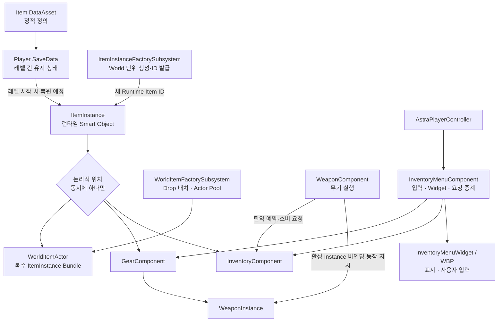
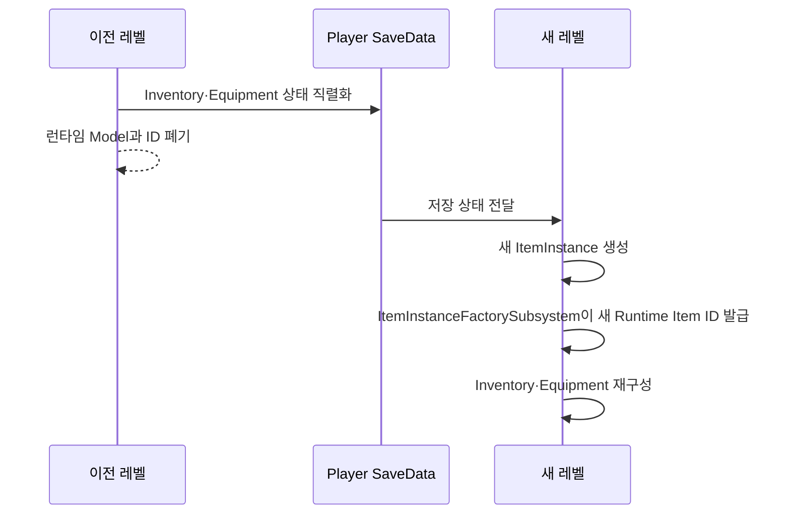
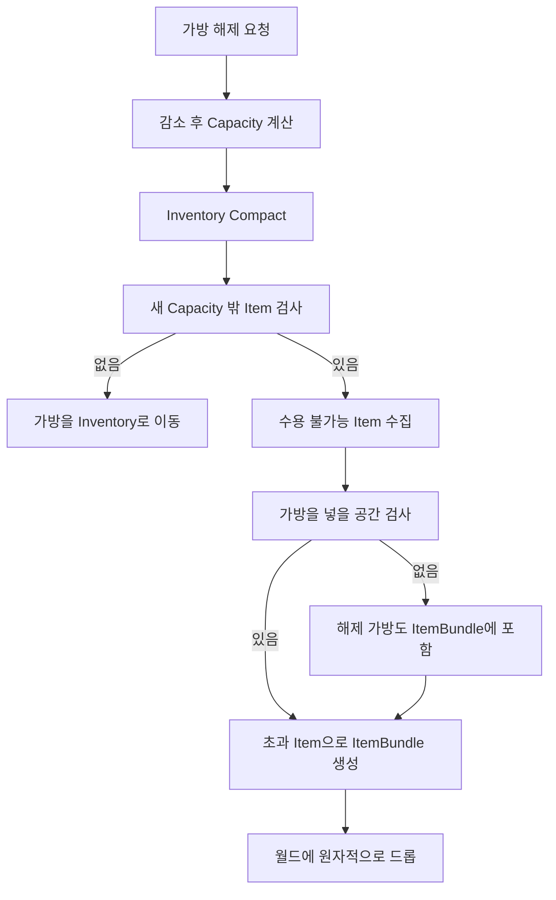

# 장비와 인벤토리

> 최종 갱신: 2026-09-02



## 상태

| 항목 | 상태 | 비고 |
|---|---|---|
| Item DataAsset·Instance 계층 | C++ 구현 | `UItemDataAsset` → `UItemInstance` 파생 구조 |
| Item Instance 생성·Runtime ID | C++ 구현 | World의 `UItemInstanceFactorySubsystem`이 담당 |
| Inventory 슬롯·Capacity·Stack | C++ 구현 | 최대 49, 기본 21, 이동·병합·분할·Compact 포함 |
| 장비 슬롯·자동 장착·교체·해제 | C++ 구현 | `UGearComponent`와 `UItemTransferComponent` |
| 탄약 Reservation·선호 탄종 | C++ 구현 | Stack과 분리, WeaponInstance Runtime ID별 예약 |
| WeaponComponent 연동 | C++ 구현 | Inventory와 활성 WeaponInstance를 참조 |
| World Item 획득·드롭·재사용 | C++ 구현 | 부분 획득, Inventory/Gear 드롭, `UWorldItemFactorySubsystem` Pool |
| Inventory·Gear Menu C++ 경계 | C++ 구현 | PlayerController 소유 MenuComponent와 Widget 이벤트·요청 API |
| Inventory·Gear Widget | Blueprint 작업 중 | 메뉴·슬롯·아이콘·Context Menu 구성, 장비 해제 확인 |
| SaveData·레벨 복원 | 설계 확정 | Schema와 직렬화 구현 전 |
| 가방 Capacity 감소·초과 드롭 | 설계 확정 | Bag 전용 Transaction 구현 전 |
| 전체 Development Editor 빌드·PIE | 일부 검증 | Editor/PIE에서 Menu와 장비 해제 경로 확인, 최신 전체 UBT 빌드 증거와 나머지 동작 검증 필요 |
| 선호·Reserved 탄 UI 표현 | 일부 미정 | 대표 Stack과 표시 방식 추후 결정 |

## 기존 설계 대비 현재 구현 차이

| 기존 설계·이전 상태 | 현재 구현 |
|---|---|
| 별도 ItemBundle 검토, WorldItem 소진 시 Actor 제거 | `AWorldItemActor` 하나가 복수 Instance Bundle 역할을 하며 소진 시 Factory Pool로 반환 |
| Inventory→World Drop 미구현 | `UWorldItemFactorySubsystem`과 ItemTransfer의 준비·제거·활성화 Transaction으로 구현 |
| Stack Split API 예정 | 새 Runtime Item ID를 발급하는 `TrySplitInventoryStack` 구현 |
| UI가 Component API를 호출한다는 개념만 존재 | PlayerController 소유 `UInventoryMenuComponent`와 `UInventoryMenuWidget` 이벤트 경계 구현 |
| UI 화면 구성 미정 | 왼쪽 Gear, 오른쪽 `7 × 7` Inventory와 Context Menu 구조로 확정·작업 중 |
| Bag·SaveData | 기존 설계대로 미구현 상태 유지 |

## 기본 원칙

Item은 플레이어 또는 다른 Entity가 획득·소유·보관·이전할 수 있는 객체다. 하나의 ItemInstance는 동시에 `World`, `Inventory`, `Gear`, `WorldItemActor`, 다른 Entity 중 한 장소에만 존재한다. UI는 Instance를 소유하거나 직접 수정하지 않고 요청과 표시만 담당한다.

```text
DataAsset = Item 종류의 정적 정의
ItemInstance = 현재 World에 존재하는 런타임 상태와 자기 상태 규칙
SaveData = 플레이어가 레벨을 넘어 유지해야 하는 직렬화 데이터
```

설계 단계의 `ItemModel`은 코드에서 `UItemInstance`로 구현됐다. Instance는 단순 데이터 구조가 아니라 자기 상태를 판단하는 Smart Object다. 예를 들어 WeaponInstance는 `HasAmmo`, `CanReload`, 탄약 호환성, 내구도 변경과 등록 탄약 상태를 판단한다. 다만 HUD 변경, Inventory 검색, 월드 Actor 생성처럼 다른 시스템을 조율하지 않는다.

> Instance는 자기 상태를 알고 판단한다. Component는 여러 Instance와 시스템 사이의 행동을 조율한다.

## 아이템 분류와 품질

```text
Item
├─ Equipment
│  ├─ Weapon
│  ├─ Armor
│  ├─ Bag
│  └─ Accessory
├─ Ammunition
├─ Ingredient
├─ QuestItem
└─ Miscellaneous
```

붙여넣은 초안의 `Projectile` Category는 월드의 Projectile Actor와 혼동될 수 있으므로 `EItemCategory::Ammunition`으로 확정·구현했다.

`Consumable`과 `Craftable`은 Item 종류가 아니라 중복 가능한 속성이다. 분류 Enum과 Model 상속 구조도 반드시 1:1로 맞추지 않는다. 단순히 DataAsset과 Quantity만 필요한 종류는 별도 Model 클래스를 만들지 않으며, 특수 런타임 상태와 규칙이 필요한 경우에만 파생 Model을 추가한다.

현재 품질 단계:

```text
EItemRarity
├─ Common
├─ Rare
├─ Unique
└─ Relic
```

## Item DataAsset 공통 데이터

`UItemInstance`는 Item 종류의 정적 정의를 가진 `UItemDataAsset`을 참조한다. Equipment와 Ammunition은 전용 DataAsset 파생 클래스로 검증한다.

```text
FName ItemID
FText ItemName
EItemCategory ItemCategory
EItemRarity ItemRarity
int32 MaxStackSize = 1
float Weight
TSoftObjectPtr<UTexture2D> ItemIcon
TSoftObjectPtr<UStaticMesh> ItemStaticMesh
bool bConsumable
bool bCanBeCraftingMaterial
bool bDismantleable
```

`bStackable`은 별도로 저장하지 않는다.

```text
MaxStackSize <= 1 → 스택 불가능
MaxStackSize > 1  → 스택 가능
```

다른 값에서 확실하게 유도할 수 있는 Bool을 중복 저장하지 않아 데이터 모순을 방지한다. 필요하면 `IsStackable()` 편의 함수로 제공한다.

`Weight`는 아이템 한 개의 무게이며 스택의 총무게는 `Weight × Quantity`다. `UItemInstance::GetTotalWeight`와 `UInventoryComponent::GetTotalWeight`까지 구현됐지만, 최대 소지 중량·과적·이동 속도·스태미나 제한은 아직 적용하지 않는다.

`bCrafted`는 정적 DataAsset에 추가하지 않는다. 제작 여부는 개별 ItemInstance의 생성 이력이므로 필요할 때 `EItemAcquisitionSource` 같은 런타임·SaveData 정보로 확장하며 정확한 값은 그때 확정한다.

## ItemInstance 계층

```text
UItemInstance
├─ RuntimeItemId
├─ ItemDataAsset
├─ Quantity
└─ 종류별 런타임 상태
```

스택 불가능한 ItemInstance는 `Quantity = 1`을 유지한다. 현재 구현 계층은 다음과 같다.

```text
UItemInstance
├─ UAmmunitionInstance
└─ UEquipmentInstance
   └─ UWeaponInstance
```

Armor·Bag·Accessory에 별도 런타임 상태가 필요하지 않다면 파생 클래스를 미리 만들지 않는다. 현재 일반 장비는 `UEquipmentInstance`로 표현한다.

Instance가 직접 HUD를 변경하거나 Inventory·Gear Component를 검색하고 World Actor를 생성하는 것은 금지한다.

## 런타임 ID와 레벨 전환

Item ID는 세이브를 넘어 유지되는 GUID가 아니라 현재 World에서 ItemInstance를 식별하는 `int64` 값이다. `UItemInstanceFactorySubsystem`이 1부터 순차 발급한다. 플레이어 소유 아이템은 향후 레벨 전환 전에 SaveData로 직렬화하고, 새 레벨에서 새로운 ItemInstance와 Runtime Item ID를 부여받는다.



이전 레벨의 ID와 새 레벨의 ID가 달라도 같은 저장 상태를 복원한 것으로 본다. 바닥에 놓인 월드 아이템은 레벨 종료와 함께 삭제하며, 모든 월드 아이템을 영속 추적하는 글로벌 Registry는 두지 않는다. ID Generator의 위치는 WorldSubsystem으로 확정됐고 SaveData Schema와 복원 코드는 아직 구현하지 않았다.

ItemInstance UObject 자체를 SaveGame에 그대로 저장하지 않고 별도 SaveData Struct로 직렬화한다.

```text
WeaponInstance → FWeaponSaveData
FWeaponSaveData → ItemInstanceFactorySubsystem → 새 WeaponInstance
```

SaveData에는 복원해야 하는 인스턴스 상태와 정적 DataAsset Definition을 찾을 식별 정보를 저장한다. 이전 Runtime Item ID는 저장하지 않는다.

## Component 책임

| Component | 책임 |
|---|---|
| InventoryComponent | ItemInstance·Slot·Capacity, Stack 이동/병합, Compact, Ammo Total/Reserved/Available와 선호 탄종 |
| GearComponent | 장비 Slot, Equip/Unequip/Swap, Auto Equip, 활성 WeaponInstance 제공 |
| ItemTransferComponent | 외부 획득과 Inventory↔Gear Transaction·Rollback, 탄약 Definition 등록·해제 |
| WeaponComponent | 활성 WeaponInstance 사용, Fire/Reload/Aim 조율, Inventory에 Reservation·Consume 요청 |
| ItemInstanceFactorySubsystem | DataAsset 실제 타입별 Instance 생성과 World 단위 Runtime ID 발급 |
| WorldItemFactorySubsystem | 드롭 위치 계산, WorldItem 준비·활성화·취소와 클래스별 Pool 관리 |
| WorldItemActor | 복수 ItemInstance 보관, 부분 획득, 소진 시 Factory Pool 반환 |
| InventoryMenuComponent | PlayerController에서 메뉴 수명·입력 모드·Widget·사용자 요청 중계 |
| InventoryMenuWidget | Blueprint가 구현할 슬롯·Tooltip·Context Menu·실패 표시 이벤트 제공 |

`AAstraPlayerState`가 InventoryComponent, GearComponent, ItemTransferComponent를 소유하므로 Pawn 교체 후에도 플레이어 장비와 Inventory Runtime 상태가 유지된다. PlayerCharacter는 GearComponent의 활성 무기 변경 이벤트를 구독하고 WeaponComponent에 해당 WeaponInstance를 바인딩한다.

## InventoryComponent

- UI 그리드: `7 × 7`, 최대 49칸
- 기본 Capacity: 21칸
- 모든 ItemInstance: 1칸 사용
- 가방과 옵션: 자유로운 정수 Capacity Modifier 적용
- 최종 Capacity 밖 슬롯: 잠금
- Item Stack, Compact와 탄약 Reservation 관리

```text
FinalCapacity = Clamp(BaseCapacity + BagModifier + OtherModifiers, 0, 49)
```

`CompactInventory`는 빈칸을 앞으로 당긴다. `TrySplitInventoryStack`은 Factory로 새로운 Runtime Item ID의 Instance를 만든 뒤 원본 Stack 수량을 줄이고 첫 빈 Slot에 보관한다. 종류·희귀도·이름 같은 기준의 `SortInventory`는 아직 구현하지 않았으며, 향후 Compact·Split과 독립된 기능으로 추가한다.

모든 Item은 `1 × 1`이며 아이템별 크기 개념은 사용하지 않는다. Capacity는 행 단위가 아니라 자유로운 Slot 수다. 예를 들어 최종 Capacity가 30이면 `0~29`는 사용 가능하고 `30~48`은 Locked 상태로 표시한다.

## GearComponent

장비 슬롯은 다음과 같다.

- Head
- Body
- Gloves
- Shoes
- Weapon 1 / Weapon 2
- Accessory 1 / Accessory 2
- Bag

GearComponent는 장착된 EquipmentInstance, 활성 무기 Slot과 WeaponInstance를 관리한다. WeaponComponent는 WeaponInstance를 직접 생성·소유하지 않고 GearComponent가 선택한 활성 WeaponInstance를 바인딩해 무기 행동을 실행한다.

현재 외부 획득은 `bAllowAutoEquip`이 켜진 경우 호환되는 빈 Slot에 장비를 자동 장착한다. Bag은 Capacity Transaction이 별도로 필요하므로 자동 장착에서 제외하고 Inventory로 보낸다. 자동 장착에 실패하거나 비활성화된 경우에도 Inventory 저장을 시도한다.

기존 슬롯에 새 장비를 장착하면 새 장비가 있던 Inventory 슬롯과 기존 장비를 Swap한다. 호환 장비 슬롯과 Inventory가 모두 가득 찼다면 획득을 실패시키고 월드 아이템을 유지한다.

```text
일반 Item
Pickup → Inventory 빈 Slot 탐색 → 이동 또는 실패

Equipment
Pickup → Auto Equip 검사
       → 호환 빈 Equipment Slot이 있으면 바로 장착
       → 없으면 Inventory로 이동
```

기존 장비와 Inventory 장비를 Swap할 때는 새 장비가 있던 Slot에 기존 장비를 돌려놓으므로 별도의 빈 Inventory Slot을 요구하지 않는다. 일반 장비 해제는 Inventory에 빈 Slot이 없으면 실패한다. 가방 해제와 더 작은 가방으로의 교체는 Capacity가 바뀌므로 별도 절차를 따른다.

## 가방 해제와 Capacity 감소



일반 Inventory↔Gear 이동은 `UItemTransferComponent`의 선검증과 명시적 Rollback으로 구현됐다. Bag Slot은 Capacity 변경과 초과 Item 처리가 필요하므로 현재 일반 Equip·Unequip API에서 거부한다.

잠길 Slot에 있던 Item을 무조건 버리지 않는다. Compact 이후 새 Capacity 안에 들어오는 Item은 유지한다.

현재는 별도 `AItemBundle` 클래스를 만들지 않고 모든 `AWorldItemActor`가 복수 ItemInstance를 보관하는 Bundle 역할을 겸한다. 레벨 배치 시 `InitialItems`를 설정하며, 각 항목의 Quantity가 MaxStackSize를 넘으면 BeginPlay에서 여러 Instance로 나눈다.

```text
AWorldItemActor
├─ UWeaponInstance
├─ UEquipmentInstance
├─ UAmmunitionInstance
└─ UItemInstance
```

## 아이템 이동 Transaction

가능한 이동 경로:

```text
World → Inventory
World → Equipment
Inventory ↔ Equipment
Inventory → WorldItemActor     구현
Equipment → WorldItemActor     구현, Bag 제외
WorldItemActor → Inventory/Gear 구현
Entity A → Entity B            미구현
```

아이템 이동은 중간 실패로 Item이 복제되거나 소실되지 않도록 하나의 Transaction처럼 처리한다.

```text
CanTransfer?
→ 전체 조건 검증
→ Transfer
→ 완료
```

현재 구현 API:

```text
InventoryComponent
├─ TryAddItemInstance / TryAddExternalItemQuantity
├─ TryRemoveItemAtSlot / TryMoveItem / TrySwapSlots
├─ TryMergeStacks / TrySplitStack / CompactInventory
└─ TrySetCapacityModifiers

GearComponent
├─ TryEquip / TryAutoEquip / TryUnequip
├─ TrySwapSlots
└─ TrySetActiveWeaponSlot

ItemTransferComponent
├─ TryStoreExternalItem / TryStoreExternalItemQuantity
├─ TryEquipFromInventory / TryUnequipToInventory
├─ TrySplitInventoryStack
└─ TryDropInventoryItem / TryDropEquipmentItem
```

Drop은 `WorldItemFactorySubsystem.PrepareWorldItem`로 비활성 Actor와 배치 위치를 먼저 확보한 뒤 Inventory 또는 Gear에서 Instance를 제거하고 Actor를 활성화한다. 제거에 실패하면 `CancelPreparedWorldItem`으로 Pool에 되돌리므로 월드 생성 실패와 보관 위치 변경 사이에서 아이템이 소실되지 않는다. 탄약 Stack은 제거 후에도 같은 Definition의 총수량이 Reservation 이상 남는 경우에만 Drop할 수 있고, Bag은 현재 Drop할 수 없다.

Entity 간 이동과 Bag 전용 Capacity Transaction은 아직 구현하지 않았다.

## 탄약과 Projectile 구분

- Ammunition Item: Inventory에 소유·보관되는 탄약
- Projectile Actor: 발사 후 월드에서 이동·충돌하는 실행 객체
- Projectile Data: 발사체의 정적 비행·충돌 정의

같은 구경에 여러 탄종이 존재할 수 있지만 한 번의 장전에는 한 탄종만 사용한다. 서로 다른 탄종을 합쳐 탄창을 채우는 혼합 장전은 허용하지 않는다.

```text
30발 무기
Inventory: AP × 10, Normal × 20
AP 선택 → AP 10발만 등록
```

## 탄약 Reservation

장전은 Ammunition Instance를 WeaponInstance로 이동시키는 작업이 아니라 Inventory가 가진 탄약의 사용 권한을 등록하는 작업이다.

```text
Inventory: TotalAmmo / ReservedAmmo / AvailableAmmo
WeaponInstance: RegisteredAmmunitionData / CurrentAmmo

AvailableAmmo = TotalAmmo - ReservedAmmo
```

발사 성공 시 Inventory의 Total/Reserved와 WeaponInstance의 CurrentAmmo를 함께 감소시킨다. 버리기·이전에는 Available 수량만 사용할 수 있다. WeaponInstance는 특정 Stack ID를 기억하지 않고 정확한 AmmunitionDataAsset과 등록 수량만 안다. 따라서 Stack Merge와 Compact가 무기 시스템과 결합되지 않는다.

```text
장전: Total 30 / Reserved 30 / Available 0
발사: Total 29 / Reserved 29 / Weapon Registered 29
```

여러 Stack에 같은 탄종이 있어도 WeaponInstance는 “Stack A에서 4발, Stack B에서 6발” 같은 배분 정보를 기억하지 않는다. InventoryComponent가 WeaponInstance의 RuntimeItemId별 Reservation을 보관하고, 실제 소비 시 같은 AmmunitionDataAsset을 가진 앞쪽 Stack부터 차감한다.

## 재장전 탄종 선택

호환 탄종이 하나면 자동 선택한다. 여러 탄종이 있으면 다음 순서로 결정한다.

1. 플레이어가 저장한 선호 탄종
2. 희귀도가 가장 낮은 탄종
3. WeaponInstance의 마지막 사용 탄종
4. 결과를 항상 동일하게 만드는 고정 기준

희귀도가 낮은 탄을 마지막 사용 탄보다 우선하는 이유는 플레이어가 귀한 탄을 의도하지 않게 소비하는 불쾌한 경험을 막기 위해서다.

선호 탄은 특정 Stack이 아니라 탄종 Definition으로 SaveData에 저장한다. 해당 탄이 0개가 되어도 설정은 유지하며 다시 획득하면 선호 탄으로 인식한다.

```text
PreferredAmmo
5.56 → DA_556_AP
9mm → DA_9mm_Normal
```

선호 탄종 저장 Map과 선택 알고리즘은 InventoryComponent에 구현됐다. 현재 Map은 Transient이므로 SaveData 직렬화는 아직 남아 있다. 선택 순위가 같으면 ItemID, Asset Path 순으로 비교해 항상 같은 결과를 만든다.

## 탄약 UI 미정 사항

같은 탄종을 여러 Stack으로 나눌 수 있으므로 탄종이 같다는 이유만으로 모든 Stack에 Glow를 표시하지 않는다. 선호 탄종 데이터와 UI에서 강조할 대표 Stack은 별개다. 대표 Stack 선정 규칙은 아직 정하지 않았다.

Reserved 상태도 Stack과 분리되어 있으므로 특정 Stack Glow로 표현한다고 가정하지 않는다. 탄종 전체 표시, 대표 Stack 하나, 별도 아이콘·수량 표시 중 어떤 방식을 사용할지는 UI 구현 단계에서 정한다.

대표 Stack을 첫 번째 Stack, Quantity가 가장 큰 Stack, 플레이어가 직접 지정한 Stack 중 무엇으로 정할지도 미확정이다.

## UI와 월드 상호작용

장비창과 Inventory UI는 Component 상태를 표시하고 Drag & Drop 또는 메뉴 요청을 전달한다. 실제 ItemInstance 위치와 Slot 상태를 UI가 소유하지 않는다.

현재 메뉴 책임은 다음처럼 구현됐다.

```text
AAstraPlayerController
└─ UInventoryMenuComponent
   ├─ IA_ToggleInventory 입력과 열기·닫기
   ├─ PlayerState의 Inventory·Gear·ItemTransfer 연결
   ├─ Slot·Capacity·Gear 변경 Delegate 구독
   ├─ Equip / Unequip / Split / Drop 요청
   └─ UInventoryMenuWidget 생성·표시
       └─ WBP_InventoryMenu와 하위 Widget이 화면 표현
```

메뉴를 열면 `Game And UI` 입력 모드, Mouse Cursor 표시와 Look Input 무시를 적용하고 닫을 때 `Game Only`로 복원한다. Widget은 슬롯과 Instance를 소유하지 않으며 `UInventoryMenuComponent`에 선택·Context Menu·행동 요청을 전달한다.

2026-09-02 현재 Blueprint에는 Inventory/Gear 슬롯, 아이콘, Inventory/Gear Context Menu와 장비 슬롯 선택용 하위 Widget이 생성돼 있다. 장비 해제는 동작 확인됐지만 장착 슬롯 선택의 최종 연결, Stack 분할 Dialog, Drop 결과, Tooltip·실패 표시와 전체 회귀 검증은 진행 중이다.

확정된 화면 구성은 전체 화면 왼쪽에 Gear, 오른쪽에 `7 × 7` Inventory를 배치하는 형태다.

```text
WBP_InventoryMenu : UInventoryMenuWidget
├─ 왼쪽 Gear 영역
│  └─ WBP_EquipmentSlot × 9
├─ 오른쪽 Inventory 영역
│  └─ UniformGridPanel
│     └─ WBP_InventorySlot × 49
├─ WBP_ItemTooltip
├─ WBP_ItemContextMenu
├─ WBP_SplitStackDialog
└─ WBP_EquipmentSlotSelectionMenu
   └─ WBP_EquipmentSlotOption × 호환 슬롯 수
```

하위 Slot Widget은 클릭을 해석해 Slot Index 또는 Equipment Slot만 발행한다. 전체 Menu가 이 이벤트를 받아 `UInventoryMenuComponent`에 요청하므로 Slot이 InventoryComponent나 GearComponent를 직접 참조하지 않는다.

```text
Pawn이 WorldItemActor의 PickupCollision과 Overlap
→ AstraPlayerState의 ItemTransferComponent 조회
→ 각 ItemInstance에서 수용 가능한 수량 계산
→ Auto Equip 또는 Inventory Stack 병합·빈 Slot 저장
→ 남은 수량은 WorldItemActor에 유지
→ 모든 Instance가 소진되면 WorldItemFactory Pool로 반환
```

현재는 별도 Interaction 시스템 전 단계이므로 Pawn Overlap 즉시 획득한다. `PickupCollision`은 Pawn만 Overlap하고 DisplayMesh는 충돌하지 않는다. WorldItemActor가 완전히 비었을 때 `OnDepleted`를 방송하고, Factory가 관리하는 Actor라면 숨김·충돌 해제·내용 초기화 후 Pool로 반환한다. Factory에 등록되지 않은 Actor만 제거한다.

드롭은 `UWorldItemFactorySettings`의 `WorldItemActorClass`와 전방 거리·지면 Trace·Offset을 사용한다. 현재 설정은 `/Game/Astra/Item/BP_ItemActor`를 가리킨다. DisplayMesh는 Blueprint에서 직접 설정하며 ItemDataAsset의 Soft `ItemStaticMesh` 자동 로딩은 아직 연결하지 않았다.

## 구현된 핵심 클래스와 다음 순서

현재 핵심 클래스:

```text
UItemInstance
UAmmunitionInstance
UEquipmentInstance
UWeaponInstance
UInventoryComponent
UGearComponent
UItemTransferComponent
UWeaponComponent
UItemDataAsset
UAmmunitionDataAsset
UEquipmentDataAsset
UWeaponDataAsset
UItemInstanceFactorySubsystem
UWorldItemFactorySubsystem
UWorldItemFactorySettings
AWorldItemActor
UInventoryMenuComponent
UInventoryMenuWidget
```

`UArmorInstance`, `UBagInstance`, `UAccessoryInstance`는 실제 특수 런타임 상태와 로직이 필요할 때 추가한다.

구현 우선순위:

1. 장착 슬롯 선택 Menu와 `RequestEquipItem` 최종 연결
2. Stack 분할 Dialog와 Inventory/Gear Drop 결과 PIE 검증
3. Tooltip·실패 표시·메뉴 열기/닫기와 Pawn 교체 회귀 검증
4. 최신 Item·Inventory·WorldItem·Menu 소스의 Development Editor / Win64 전체 빌드
5. WorldItem Overlap, 부분 Stack 획득, Auto Equip과 Pool 재사용 PIE 검증
6. Bag 장착·해제·교체와 Capacity 감소·초과 WorldItem 생성 Transaction
7. Inventory Sort와 Entity 간 Transfer
8. SaveData Schema·Load·Level Transition 재구성
9. Preferred/Reserved 탄약 UI 표현
10. ItemStaticMesh Soft Reference 로딩·취소 정책

구현 시 `UObject Outer`, `UPROPERTY/TObjectPtr`, Garbage Collection, UObject 생성 위치, ID Generator 수명, SaveGame 직렬화, DataAsset Reference 저장 방식과 레벨 전환 재구성을 함께 검토한다.

## 구현 원칙 요약

1. 정적 정보는 DataAsset에 둔다.
2. 런타임 개별 상태는 ItemInstance에 둔다.
3. 레벨 간 유지 상태는 별도 SaveData에 둔다.
4. Instance는 Smart Object지만 다른 시스템을 직접 찾아 제어하지 않는다.
5. Component가 Instance와 시스템 사이의 상호작용을 조율한다.
6. 하나의 ItemInstance는 논리적으로 한 장소에만 존재한다.
7. Item 이동은 소실 방지를 위해 Transaction 형태로 처리한다.
8. 다른 값에서 확실하게 유도되는 Bool은 저장하지 않는다.
9. Runtime Item ID는 레벨 단위이며 SaveData에 유지하지 않는다.
10. UI 표현을 위해 핵심 시스템 데이터를 왜곡하지 않는다.

---

## 상위 페이지

- [03_시스템 설계](03_%EC%8B%9C%EC%8A%A4%ED%85%9C%20%EC%84%A4%EA%B3%84.md)

## 관련

- [Item](객체%20설계/Item.md)
- [무기 시스템](%EB%AC%B4%EA%B8%B0%20%EC%8B%9C%EC%8A%A4%ED%85%9C.md)
- [게임 객체 분류](../02_%EA%B2%8C%EC%9E%84%20%EA%B8%B0%ED%9A%8D/%EA%B2%8C%EC%9E%84%20%EA%B0%9D%EC%B2%B4%20%EB%B6%84%EB%A5%98.md)
- [Player](%EA%B0%9D%EC%B2%B4%20%EC%84%A4%EA%B3%84/Player.md)
- [남은 이슈](../01_%EC%9D%BC%EC%A0%95%20%EA%B4%80%EB%A6%AC/%EB%82%A8%EC%9D%80%20%EC%9D%B4%EC%8A%88.md)
