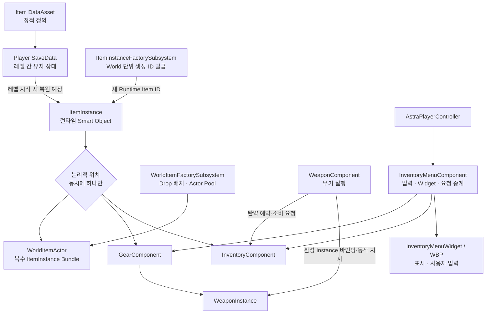
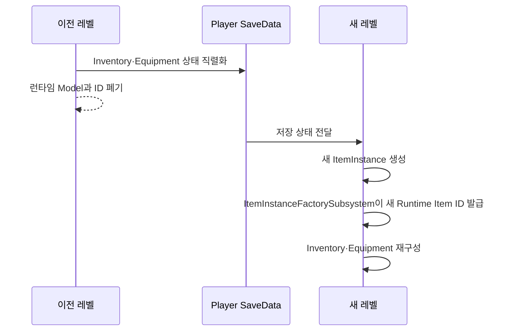

# 장비와 인벤토리

## 설계 의도

> 최종 갱신: 2026-09-08



## 상태

| 항목 | 상태 | 비고 |
|---|---|---|
| Item DataAsset·Instance 계층 | C++ 구현 | `UItemDataAsset` → `UItemInstance` 파생 구조 |
| CSV 기반 DataAsset 구성 | C++ Editor 도구 구현 | ItemID 조립, 9개 Weapon CSV와 Ammunition CSV 검증·적용 |
| Item Instance 생성·Runtime ID | C++ 구현 | World의 `UItemInstanceFactorySubsystem`이 담당 |
| Inventory 슬롯·Capacity·Stack | C++ 구현 | 최대 49, 기본 21, 이동·병합·분할·Compact 포함 |
| 장비 슬롯·자동 장착·교체·해제 | C++ 구현 | `UGearComponent`와 `UItemTransferComponent` |
| 탄약 Reservation·선호 탄종 | C++ 구현 | Stack과 분리, WeaponInstance Runtime ID별 예약 |
| WeaponComponent 연동 | C++ 구현 | Inventory와 활성 WeaponInstance를 참조 |
| World Item 획득·드롭·재사용 | C++ 구현 | 부분 획득, Inventory/Gear 드롭, `UWorldItemFactorySubsystem` Pool |
| Inventory·Gear Menu C++ 경계 | C++ 구현 | PlayerController 소유 MenuComponent와 Widget 이벤트·요청 API |
| Inventory·Gear Widget | Blueprint 작업 중 | 메뉴·슬롯·아이콘·Context Menu 구성, 장비 해제 확인 |
| Tooltip 데이터 경계 | C++ 구현 | `FItemTooltipViewData` 스냅샷 전달. Blueprint 컴파일·종류별 표시 검증 필요 |
| SaveData·레벨 복원 | 설계 확정 | Schema와 직렬화 구현 전 |
| 가방 Capacity 감소·초과 드롭 | 설계 확정 | Bag 전용 Transaction 구현 전 |
| 전체 Development Editor 빌드·PIE | 빌드 성공·PIE 일부 검증 | 2026-09-08 UBT `Result: Succeeded`. Tooltip과 신규 데이터 구조 회귀 검증 필요 |
| 선호·Reserved 탄 UI 표현 | 일부 미정 | 대표 Stack과 표시 방식 추후 결정 |

## 기존 설계 대비 현재 구현 차이

| 기존 설계·이전 상태 | 현재 구현 |
|---|---|
| 별도 ItemBundle 검토, WorldItem 소진 시 Actor 제거 | `AWorldItemActor` 하나가 복수 Instance Bundle 역할을 하며 소진 시 Factory Pool로 반환 |
| Inventory→World Drop 미구현 | `UWorldItemFactorySubsystem`과 ItemTransfer의 준비·제거·활성화 Transaction으로 구현 |
| Stack Split API 예정 | 새 Runtime Item ID를 발급하는 `TrySplitInventoryStack` 구현 |
| UI가 Component API를 호출한다는 개념만 존재 | PlayerController 소유 `UInventoryMenuComponent`와 `UInventoryMenuWidget` 이벤트 경계 구현 |
| UI 화면 구성 미정 | 왼쪽 Gear, 오른쪽 `7 × 7` Inventory와 Context Menu 구조로 확정·작업 중 |
| UI가 원본 ItemInstance를 Tooltip에 전달 | MenuComponent가 `FItemTooltipViewData` 값 스냅샷을 구성해 Widget에 전달 |
| Weapon 수치가 한 DataAsset에 수동 입력 | 공통 Item·Equipment와 9개 Weapon CSV를 `ItemID`로 조립 |
| 별도 Projectile ID·DataAsset | Projectile 정적 정의를 AmmunitionDataAsset에 통합 |
| 최대 내구도가 Weapon 전용 | EquipmentDataAsset·EquipmentInstance 공통 책임으로 이동 |
| Bag·SaveData | 기존 설계대로 미구현 상태 유지 |

## 기본 원칙

기획 규칙: [장비와 인벤토리](../02_%EA%B2%8C%EC%9E%84%20%EA%B8%B0%ED%9A%8D/%EC%8B%9C%EC%8A%A4%ED%85%9C%20%EA%B8%B0%ED%9A%8D/%EC%9E%A5%EB%B9%84%EC%99%80%20%EC%9D%B8%EB%B2%A4%ED%86%A0%EB%A6%AC.md)

- 정적 정의: DataAsset
- 런타임 상태·자기 상태 판단: ItemInstance
- 레벨 간 직렬화: SaveData
- 시스템 사이 조율: Component
- UI: 요청·표시
- Instance 직접 소유·수정 없음

## 아이템 분류와 품질

종류·품질 정의: [Item](../02_%EA%B2%8C%EC%9E%84%20%EA%B8%B0%ED%9A%8D/%EA%B0%9D%EC%B2%B4%20%EA%B8%B0%ED%9A%8D/Item.md)

- 분류 Enum: EItemCategory
- 품질 Enum: EItemRarity
- 탄약 Category: Ammunition
- 별도 Instance 파생: 특수 상태·규칙이 필요한 종류만 추가

## Item DataAsset 공통 데이터

`UItemInstance`는 Item 종류의 정적 정의를 가진 `UItemDataAsset`을 참조

Equipment와 Ammunition은 전용 DataAsset 파생 클래스로 검증

```text
FName ItemID
FText ItemName
EItemCategory ItemCategory
EItemRarity ItemRarity
int32 MaxStackSize = 1
float Weight
TSoftObjectPtr<UTexture2D> ItemIcon
TSoftObjectPtr<UStaticMesh> ItemStaticMesh
bool bConsumable
bool bCanBeCraftingMaterial
bool bDismantleable
```

`bStackable`은 별도로 저장하지 않음

```text
MaxStackSize <= 1 → 스택 불가능
MaxStackSize > 1  → 스택 가능
```

다른 값에서 확실하게 유도할 수 있는 Bool을 중복 저장하지 않아 데이터 모순을 방지

필요하면 `IsStackable()` 편의 함수로 제공

`Weight`는 아이템 한 개의 무게이며 스택의 총무게는 `Weight × Quantity`다

`UItemInstance::GetTotalWeight`와 `UInventoryComponent::GetTotalWeight`까지 구현됐지만, 최대 소지 중량·과적·이동 속도·스태미나 제한은 아직 적용하지 않음

`bCrafted`는 정적 DataAsset에 추가하지 않음

제작 여부는 개별 ItemInstance의 생성 이력이므로 필요할 때 `EItemAcquisitionSource` 같은 런타임·SaveData 정보로 확장하며 정확한 값은 그때 확정

### ItemID와 CSV 조립

`ItemID`는 정적 정의의 조립 키

`RuntimeItemId`는 현재 World에서 생성된 ItemInstance 식별자

```text
Equipment.Weapon.BasePistol
Ammunition.Base9mm
```

작성 규칙:

- `<대분류>.<세부분류>.<고유명>`
- Unreal Asset 접두어 `DA_`, `BP_` 제외
- Manifest와 모든 관련 CSV에서 같은 ItemID 사용
- Gameplay Tag는 ID가 아니라 분류·호환 규칙에 사용

현재 Editor Import 구성:

```text
ItemAssetManifest.csv
├─ 01_Item.csv
├─ Equipment/01_Equipment.csv
├─ Equipment/Weapon/01_Weapon.csv
│  ├─ WeaponDamage.csv
│  ├─ WeaponFire.csv
│  ├─ WeaponAmmo.csv
│  ├─ WeaponContinuous.csv
│  ├─ WeaponCharge.csv
│  ├─ WeaponAim.csv
│  ├─ WeaponRecoil.csv
│  └─ WeaponAccuracy.csv
└─ Ammunition/01_Ammunition.csv
```

Importer는 `CsvSource` Metadata와 CSV Header를 대조하고, ItemID별 행을 실제 DataAsset 파생 타입에 적용

에셋 참조·Socket·Transform은 DataAsset에서 직접 설정

## ItemInstance 계층

```text
UItemInstance
├─ RuntimeItemId
├─ ItemDataAsset
├─ Quantity
└─ 종류별 런타임 상태
```

스택 불가능한 ItemInstance는 `Quantity = 1`을 유지

현재 구현 계층은 다음과 같다

```text
UItemInstance
├─ UAmmunitionInstance
└─ UEquipmentInstance
   └─ UWeaponInstance
```

Armor·Bag·Accessory에 별도 런타임 상태가 필요하지 않다면 파생 클래스를 미리 만들지 않음

현재 일반 장비는 `UEquipmentInstance`로 표현

## 장비 공통 내구도

- 최대 내구도: `UEquipmentDataAsset::MaxDurability`
- 현재 내구도: `UEquipmentInstance::CurrentDurability`
- `MaxDurability = -1`: 파손되지 않음
- 내구도 0: ItemInstance 유지, `IsBroken = true`
- 파손 무기: Draw·Fire·Aim·Reload 요청 거부
- 실패 표시: `장비가 파손되었다`
- 해제: 사용자 직접 수행

Instance가 직접 HUD를 변경하거나 Inventory·Gear Component를 검색하고 World Actor를 생성하는 것은 금지

## 런타임 ID와 레벨 전환

Item ID는 세이브를 넘어 유지되는 GUID가 아니라 현재 World에서 ItemInstance를 식별하는 `int64` 값

`UItemInstanceFactorySubsystem`이 1부터 순차 발급

플레이어 소유 아이템은 향후 레벨 전환 전에 SaveData로 직렬화하고, 새 레벨에서 새로운 ItemInstance와 Runtime Item ID를 부여받음



이전 레벨의 ID와 새 레벨의 ID가 달라도 같은 저장 상태를 복원한 것으로 판단

바닥에 놓인 월드 아이템은 레벨 종료와 함께 삭제하며, 모든 월드 아이템을 영속 추적하는 글로벌 Registry는 두지 않음

ID Generator의 위치는 WorldSubsystem으로 확정됐고 SaveData Schema와 복원 코드는 아직 구현하지 않았다

ItemInstance UObject 자체를 SaveGame에 그대로 저장하지 않고 별도 SaveData Struct로 직렬화

```text
WeaponInstance → FWeaponSaveData
FWeaponSaveData → ItemInstanceFactorySubsystem → 새 WeaponInstance
```

SaveData에는 복원해야 하는 인스턴스 상태와 정적 DataAsset Definition을 찾을 식별 정보를 저장

이전 Runtime Item ID는 저장하지 않음

## Component 책임

| Component | 책임 |
|---|---|
| InventoryComponent | ItemInstance·Slot·Capacity, Stack 이동/병합, Compact, Ammo Total/Reserved/Available와 선호 탄종 |
| GearComponent | 장비 Slot, Equip/Unequip/Swap, Auto Equip, 활성 WeaponInstance 제공 |
| ItemTransferComponent | 외부 획득과 Inventory↔Gear Transaction·Rollback, 탄약 Definition 등록·해제 |
| WeaponComponent | 활성 WeaponInstance 사용, Fire/Reload/Aim 조율, Inventory에 Reservation·Consume 요청 |
| ItemInstanceFactorySubsystem | DataAsset 실제 타입별 Instance 생성과 World 단위 Runtime ID 발급 |
| WorldItemFactorySubsystem | 드롭 위치 계산, WorldItem 준비·활성화·취소와 클래스별 Pool 관리 |
| WorldItemActor | 복수 ItemInstance 보관, 부분 획득, 소진 시 Factory Pool 반환 |
| InventoryMenuComponent | PlayerController에서 메뉴 수명·입력 모드·Widget·사용자 요청 중계 |
| InventoryMenuWidget | Blueprint가 구현할 슬롯·Tooltip·Context Menu·실패 표시 이벤트 제공 |

`AAstraPlayerState`가 InventoryComponent, GearComponent, ItemTransferComponent를 소유하므로 Pawn 교체 후에도 플레이어 장비와 Inventory Runtime 상태가 유지됨

PlayerCharacter는 GearComponent의 활성 무기 변경 이벤트를 구독하고 WeaponComponent에 해당 WeaponInstance를 바인딩

## InventoryComponent

공간·스택 규칙: [장비와 인벤토리](../02_%EA%B2%8C%EC%9E%84%20%EA%B8%B0%ED%9A%8D/%EC%8B%9C%EC%8A%A4%ED%85%9C%20%EA%B8%B0%ED%9A%8D/%EC%9E%A5%EB%B9%84%EC%99%80%20%EC%9D%B8%EB%B2%A4%ED%86%A0%EB%A6%AC.md)

```text
FinalCapacity = Clamp(BaseCapacity + BagModifier + OtherModifiers, 0, 49)
```

- CompactInventory: 앞쪽 빈 Slot 정리
- TrySplitInventoryStack: Factory에서 새 Runtime ID 발급 → 원본 수량 감소 → 빈 Slot 저장
- SortInventory: 미구현
- Compact·Split과 분리
- Locked Slot: Index >= FinalCapacity

## GearComponent

슬롯·자동 장착·교체·해제 규칙: [장비와 인벤토리](../02_%EA%B2%8C%EC%9E%84%20%EA%B8%B0%ED%9A%8D/%EC%8B%9C%EC%8A%A4%ED%85%9C%20%EA%B8%B0%ED%9A%8D/%EC%9E%A5%EB%B9%84%EC%99%80%20%EC%9D%B8%EB%B2%A4%ED%86%A0%EB%A6%AC.md)

- EquipmentInstance·활성 Weapon Slot 관리
- WeaponComponent에 활성 WeaponInstance 바인딩
- 외부 획득: bAllowAutoEquip 검사 → 호환 빈 Slot → 실패 시 Inventory 저장
- Bag: 일반 Equip·Unequip·AutoEquip 경로 제외
- 교체: 새 장비의 원래 Inventory Slot으로 이전 장비 반환
- 선검증 실패: 원래 소유 위치 유지

## 가방 해제와 Capacity 감소

기획 절차: [장비와 인벤토리](../02_%EA%B2%8C%EC%9E%84%20%EA%B8%B0%ED%9A%8D/%EC%8B%9C%EC%8A%A4%ED%85%9C%20%EA%B8%B0%ED%9A%8D/%EC%9E%A5%EB%B9%84%EC%99%80%20%EC%9D%B8%EB%B2%A4%ED%86%A0%EB%A6%AC.md)

- 현재 Bag 전용 Capacity Transaction 미구현
- 일반 Inventory↔Gear: ItemTransferComponent 선검증·Rollback 사용
- AWorldItemActor: 복수 ItemInstance Bundle
- InitialItems 수량이 MaxStackSize 초과 시 BeginPlay에서 여러 Instance 생성
- 별도 AItemBundle 클래스 없음

## 아이템 이동 Transaction

가능한 이동 경로:

```text
World → Inventory
World → Equipment
Inventory ↔ Equipment
Inventory → WorldItemActor     구현
Equipment → WorldItemActor     구현, Bag 제외
WorldItemActor → Inventory/Gear 구현
Entity A → Entity B            미구현
```

아이템 이동은 중간 실패로 Item이 복제되거나 소실되지 않도록 하나의 Transaction처럼 처리

```text
CanTransfer?
→ 전체 조건 검증
→ Transfer
→ 완료
```

현재 구현 API:

```text
InventoryComponent
├─ TryAddItemInstance / TryAddExternalItemQuantity
├─ TryRemoveItemAtSlot / TryMoveItem / TrySwapSlots
├─ TryMergeStacks / TrySplitStack / CompactInventory
└─ TrySetCapacityModifiers

GearComponent
├─ TryEquip / TryAutoEquip / TryUnequip
├─ TrySwapSlots
└─ TrySetActiveWeaponSlot

ItemTransferComponent
├─ TryStoreExternalItem / TryStoreExternalItemQuantity
├─ TryEquipFromInventory / TryUnequipToInventory
├─ TrySplitInventoryStack
└─ TryDropInventoryItem / TryDropEquipmentItem
```

Drop은 `WorldItemFactorySubsystem.PrepareWorldItem`로 비활성 Actor와 배치 위치를 먼저 확보한 뒤 Inventory 또는 Gear에서 Instance를 제거하고 Actor를 활성화

제거에 실패하면 `CancelPreparedWorldItem`으로 Pool에 되돌리므로 월드 생성 실패와 보관 위치 변경 사이에서 아이템이 소실되지 않음

탄약 Stack은 제거 후에도 같은 Definition의 총수량이 Reservation 이상 남는 경우에만 Drop할 수 있고, Bag은 현재 Drop할 수 없음

Entity 간 이동과 Bag 전용 Capacity Transaction은 아직 구현하지 않았다

## 탄약과 Projectile 구분

탄종·혼합 장전 규칙: [장비와 인벤토리](../02_%EA%B2%8C%EC%9E%84%20%EA%B8%B0%ED%9A%8D/%EC%8B%9C%EC%8A%A4%ED%85%9C%20%EA%B8%B0%ED%9A%8D/%EC%9E%A5%EB%B9%84%EC%99%80%20%EC%9D%B8%EB%B2%A4%ED%86%A0%EB%A6%AC.md)

- AmmunitionInstance: Inventory 보관 데이터
- AmmunitionDataAsset: 탄종 호환성과 비행·충돌·발사체 Class·Impact 정적 정의
- ProjectileActor: 발사 후 월드 실행 객체

별도 ProjectileID·Projectile CSV·ProjectileDataAsset은 사용하지 않음

## 탄약 Reservation

장전은 Ammunition Instance를 WeaponInstance로 이동시키는 작업이 아니라 Inventory가 가진 탄약의 사용 권한을 등록하는 작업

```text
Inventory: TotalAmmo / ReservedAmmo / AvailableAmmo
WeaponInstance: RegisteredAmmunitionData / CurrentAmmo

AvailableAmmo = TotalAmmo - ReservedAmmo
```

발사 성공 시 Inventory의 Total/Reserved와 WeaponInstance의 CurrentAmmo를 함께 감소시킨다

버리기·이전에는 Available 수량만 사용 가능

WeaponInstance는 특정 Stack ID를 기억하지 않고 정확한 AmmunitionDataAsset과 등록 수량만 안다

따라서 Stack Merge와 Compact가 무기 시스템과 결합되지 않음

```text
장전: Total 30 / Reserved 30 / Available 0
발사: Total 29 / Reserved 29 / Weapon Registered 29
```

여러 Stack에 같은 탄종이 있어도 WeaponInstance는 “Stack A에서 4발, Stack B에서 6발” 같은 배분 정보를 기억하지 않음

InventoryComponent가 WeaponInstance의 RuntimeItemId별 Reservation을 보관하고, 실제 소비 시 같은 AmmunitionDataAsset을 가진 앞쪽 Stack부터 차감

## 재장전 탄종 선택

선택 우선순위: [장비와 인벤토리](../02_%EA%B2%8C%EC%9E%84%20%EA%B8%B0%ED%9A%8D/%EC%8B%9C%EC%8A%A4%ED%85%9C%20%EA%B8%B0%ED%9A%8D/%EC%9E%A5%EB%B9%84%EC%99%80%20%EC%9D%B8%EB%B2%A4%ED%86%A0%EB%A6%AC.md)

- 선택 알고리즘·선호 탄종 Map: InventoryComponent
- 선호 값: Ammunition Definition
- 동순위 결정: ItemID → Asset Path
- 현재 Map: Transient
- SaveData 직렬화: 미구현

## 탄약 UI 미정 사항

표현 정책: [장비와 인벤토리](../02_%EA%B2%8C%EC%9E%84%20%EA%B8%B0%ED%9A%8D/%EC%8B%9C%EC%8A%A4%ED%85%9C%20%EA%B8%B0%ED%9A%8D/%EC%9E%A5%EB%B9%84%EC%99%80%20%EC%9D%B8%EB%B2%A4%ED%86%A0%EB%A6%AC.md)

- 선호 탄종·Reservation과 대표 Stack 표시 분리
- 대표 Stack·Glow·아이콘 연결:

## UI와 월드 상호작용

장비창과 Inventory UI는 Component 상태를 표시하고 Drag & Drop 또는 메뉴 요청을 전달

실제 ItemInstance 위치와 Slot 상태를 UI가 소유하지 않음

현재 메뉴 책임은 다음처럼 구현됐다

```text
AAstraPlayerController
└─ UInventoryMenuComponent
   ├─ IA_ToggleInventory 입력과 열기·닫기
   ├─ PlayerState의 Inventory·Gear·ItemTransfer 연결
   ├─ Slot·Capacity·Gear 변경 Delegate 구독
   ├─ Equip / Unequip / Split / Drop 요청
   └─ UInventoryMenuWidget 생성·표시
       └─ WBP_InventoryMenu와 하위 Widget이 화면 표현
```

메뉴를 열면 `Game And UI` 입력 모드, Mouse Cursor 표시와 Look Input 무시를 적용하고 닫을 때 `Game Only`로 복원

Widget은 슬롯과 Instance를 소유하지 않으며 `UInventoryMenuComponent`에 선택·Context Menu·행동 요청을 전달

2026-09-08 현재 Blueprint에는 Inventory/Gear 슬롯, 아이콘, Inventory/Gear Context Menu와 장비 슬롯 선택용 하위 Widget이 생성돼 있음

2026-09-03 대화 확인: 장비 해제 동작 확인, 장착 옵션 enum 저장 수정 반영, Stack 분할 해결 완료

2026-09-08 C++은 선택한 Inventory·Gear Item을 `FItemTooltipViewData`로 변환해 Widget Event에 전달

현재 ViewData 범위:

```text
공통: ItemName · Category · Rarity · Icon · Quantity · Stack · Weight
Equipment: EquipmentType · CurrentDurability · MaxDurability
Weapon: WeaponType · BaseDamage
```

현재 단일 Struct로 시작

필드가 늘면 Common·Equipment·Weapon·Ammunition 하위 Struct로 분리

지속적인 양방향 갱신이 필요해질 때만 UObject ViewModel 검토

WBP_InventoryMenu 저장 기록은 있으나 변경된 `DisplayItemTooltip` 서명에 대한 Blueprint 최종 컴파일과 Item 종류별 PIE 표시는 미확인

Drop 결과·Tooltip·실패 표시·장착 조합·전체 회귀 검증은 별도

확정된 화면 구성은 전체 화면 왼쪽에 Gear, 오른쪽에 `7 × 7` Inventory를 배치하는 형태다

```text
WBP_InventoryMenu : UInventoryMenuWidget
├─ 왼쪽 Gear 영역
│  └─ WBP_EquipmentSlot × 9
├─ 오른쪽 Inventory 영역
│  └─ UniformGridPanel
│     └─ WBP_InventorySlot × 49
├─ WBP_ItemTooltip
├─ WBP_ItemContextMenu
├─ WBP_SplitStackDialog
└─ WBP_EquipmentSlotSelectionMenu
   └─ WBP_EquipmentSlotOption × 호환 슬롯 수
```

하위 Slot Widget은 클릭을 해석해 Slot Index 또는 Equipment Slot만 발행

전체 Menu가 이 이벤트를 받아 `UInventoryMenuComponent`에 요청하므로 Slot이 InventoryComponent나 GearComponent를 직접 참조하지 않음

```text
Pawn이 WorldItemActor의 PickupCollision과 Overlap
→ AstraPlayerState의 ItemTransferComponent 조회
→ 각 ItemInstance에서 수용 가능한 수량 계산
→ Auto Equip 또는 Inventory Stack 병합·빈 Slot 저장
→ 남은 수량은 WorldItemActor에 유지
→ 모든 Instance가 소진되면 WorldItemFactory Pool로 반환
```

현재는 별도 Interaction 시스템 전 단계이므로 Pawn Overlap 즉시 획득

`PickupCollision`은 Pawn만 Overlap하고 DisplayMesh는 충돌하지 않음

WorldItemActor가 완전히 비었을 때 `OnDepleted`를 방송하고, Factory가 관리하는 Actor라면 숨김·충돌 해제·내용 초기화 후 Pool로 반환

Factory에 등록되지 않은 Actor만 제거

드롭은 `UWorldItemFactorySettings`의 `WorldItemActorClass`와 전방 거리·지면 Trace·Offset을 사용

현재 설정은 `/Game/Astra/Item/BP_ItemActor`를 가리킨다

DisplayMesh는 Blueprint에서 직접 설정하며 ItemDataAsset의 Soft `ItemStaticMesh` 자동 로딩은 아직 연결하지 않았다

## 구현된 핵심 클래스와 다음 순서

현재 핵심 클래스:

```text
UItemInstance
UAmmunitionInstance
UEquipmentInstance
UWeaponInstance
UInventoryComponent
UGearComponent
UItemTransferComponent
UWeaponComponent
UItemDataAsset
UAmmunitionDataAsset
UEquipmentDataAsset
UWeaponDataAsset
UItemInstanceFactorySubsystem
UWorldItemFactorySubsystem
UWorldItemFactorySettings
AWorldItemActor
UInventoryMenuComponent
UInventoryMenuWidget
```

`UArmorInstance`, `UBagInstance`, `UAccessoryInstance`는 실제 특수 런타임 상태와 로직이 필요할 때 추가

구현 우선순위:

1. 장착 슬롯 조합·교체의 회귀 검증
2. Stack 분할 실패·취소 경로와 Inventory/Gear Drop 결과 PIE 검증
3. Tooltip Blueprint 재컴파일·종류별 표시·실패 표시·메뉴 열기/닫기와 Pawn 교체 회귀 검증
4. 신규 Item·Ammunition·Weapon CSV Import와 DataAsset 값 회귀 검증
5. WorldItem Overlap, 부분 Stack 획득, Auto Equip과 Pool 재사용 PIE 검증
6. Bag 장착·해제·교체와 Capacity 감소·초과 WorldItem 생성 Transaction
7. Inventory Sort와 Entity 간 Transfer
8. SaveData Schema·Load·Level Transition 재구성
9. Preferred/Reserved 탄약 UI 표현
10. ItemStaticMesh Soft Reference 로딩·취소 정책

구현 시 `UObject Outer`, `UPROPERTY/TObjectPtr`, Garbage Collection, UObject 생성 위치, ID Generator 수명, SaveGame 직렬화, DataAsset Reference 저장 방식과 레벨 전환 재구성을 함께 검토

## 구현 원칙 요약

1. 정적 정보는 DataAsset에 둠
2. 런타임 개별 상태는 ItemInstance에 둠
3. 레벨 간 유지 상태는 별도 SaveData에 둠
4. Instance는 Smart Object지만 다른 시스템을 직접 찾아 제어하지 않음
5. Component가 Instance와 시스템 사이의 상호작용을 조율
6. 하나의 ItemInstance는 논리적으로 한 장소에만 존재
7. Item 이동은 소실 방지를 위해 Transaction 형태로 처리
8. 다른 값에서 확실하게 유도되는 Bool은 저장하지 않음
9. Runtime Item ID는 레벨 단위이며 SaveData에 유지하지 않음
10. UI 표현을 위해 핵심 시스템 데이터를 왜곡하지 않음
11. Tooltip은 원본 객체 대신 C++에서 만든 값 스냅샷을 전달

---

## 상위 페이지

- [03_시스템 설계](03_%EC%8B%9C%EC%8A%A4%ED%85%9C%20%EC%84%A4%EA%B3%84.md)

## 관련

- [Item](객체%20설계/Item.md)
- [무기 시스템](%EB%AC%B4%EA%B8%B0.md)
- [게임 객체 분류](../02_%EA%B2%8C%EC%9E%84%20%EA%B8%B0%ED%9A%8D/%EA%B2%8C%EC%9E%84%20%EA%B0%9D%EC%B2%B4%20%EB%B6%84%EB%A5%98.md)
- [Player](%EA%B0%9D%EC%B2%B4%20%EC%84%A4%EA%B3%84/%ED%94%8C%EB%A0%88%EC%9D%B4%EC%96%B4.md)
- [남은 이슈](../01_%EC%9D%BC%EC%A0%95%20%EA%B4%80%EB%A6%AC/%EB%82%A8%EC%9D%80%20%EC%9D%B4%EC%8A%88.md)

## 문서 연결

- 기획: [장비와 인벤토리](../02_%EA%B2%8C%EC%9E%84%20%EA%B8%B0%ED%9A%8D/%EC%8B%9C%EC%8A%A4%ED%85%9C%20%EA%B8%B0%ED%9A%8D/%EC%9E%A5%EB%B9%84%EC%99%80%20%EC%9D%B8%EB%B2%A4%ED%86%A0%EB%A6%AC.md)
- 시스템 설계: [장비와 인벤토리](%EC%9E%A5%EB%B9%84%EC%99%80%20%EC%9D%B8%EB%B2%A4%ED%86%A0%EB%A6%AC.md)
- 애니메이션 설계: [장비와 인벤토리](../04_%EC%95%84%ED%8A%B8%20%EB%B0%8F%20%EC%95%A0%EB%8B%88%EB%A9%94%EC%9D%B4%EC%85%98/%EC%95%A0%EB%8B%88%EB%A9%94%EC%9D%B4%EC%85%98%20%EC%84%A4%EA%B3%84/%EC%9E%A5%EB%B9%84%EC%99%80%20%EC%9D%B8%EB%B2%A4%ED%86%A0%EB%A6%AC.md)

## UI 제작 기술 가이드

- [슬롯 크기와 스크롤](../08_%EA%B8%B0%EC%88%A0%20%EC%9C%84%ED%82%A4_%EA%B3%B5%ED%86%B5%20%EA%B0%80%EC%9D%B4%EB%93%9C/Unreal/UMG/%EC%8A%AC%EB%A1%AF%20%ED%81%AC%EA%B8%B0%EC%99%80%20%EC%8A%A4%ED%81%AC%EB%A1%A4.md)
- [마우스 입력과 이벤트 디스패처](../08_%EA%B8%B0%EC%88%A0%20%EC%9C%84%ED%82%A4_%EA%B3%B5%ED%86%B5%20%EA%B0%80%EC%9D%B4%EB%93%9C/Unreal/UMG/%EB%A7%88%EC%9A%B0%EC%8A%A4%20%EC%9E%85%EB%A0%A5%EA%B3%BC%20%EC%9D%B4%EB%B2%A4%ED%8A%B8%20%EB%94%94%EC%8A%A4%ED%8C%A8%EC%B2%98.md)
- [동적 위젯 생성과 데이터 갱신](../08_%EA%B8%B0%EC%88%A0%20%EC%9C%84%ED%82%A4_%EA%B3%B5%ED%86%B5%20%EA%B0%80%EC%9D%B4%EB%93%9C/Unreal/UMG/%EB%8F%99%EC%A0%81%20%EC%9C%84%EC%A0%AF%20%EC%83%9D%EC%84%B1%EA%B3%BC%20%EB%8D%B0%EC%9D%B4%ED%84%B0%20%EA%B0%B1%EC%8B%A0.md)
- [팝업 위치와 화면 경계](../08_%EA%B8%B0%EC%88%A0%20%EC%9C%84%ED%82%A4_%EA%B3%B5%ED%86%B5%20%EA%B0%80%EC%9D%B4%EB%93%9C/Unreal/UMG/%ED%8C%9D%EC%97%85%20%EC%9C%84%EC%B9%98%EC%99%80%20%ED%99%94%EB%A9%B4%20%EA%B2%BD%EA%B3%84.md)
- [수량 입력과 Stack 분할](../08_%EA%B8%B0%EC%88%A0%20%EC%9C%84%ED%82%A4_%EA%B3%B5%ED%86%B5%20%EA%B0%80%EC%9D%B4%EB%93%9C/Unreal/UMG/%EC%88%98%EB%9F%89%20%EC%9E%85%EB%A0%A5%EA%B3%BC%20Stack%20%EB%B6%84%ED%95%A0.md)
- [Tooltip ViewData와 ViewModel](../08_%EA%B8%B0%EC%88%A0%20%EC%9C%84%ED%82%A4_%EA%B3%B5%ED%86%B5%20%EA%B0%80%EC%9D%B4%EB%93%9C/Unreal/UMG/Tooltip%20ViewData%EC%99%80%20ViewModel.md)
- [CSV 기반 DataAsset 구성](../08_%EA%B8%B0%EC%88%A0%20%EC%9C%84%ED%82%A4_%EA%B3%B5%ED%86%B5%20%EA%B0%80%EC%9D%B4%EB%93%9C/Unreal/Assets/CSV%20%EA%B8%B0%EB%B0%98%20DataAsset%20%EA%B5%AC%EC%84%B1.md)
- [기술 이슈와 검증 범위](../08_%EA%B8%B0%EC%88%A0%20%EC%9C%84%ED%82%A4_%EA%B3%B5%ED%86%B5%20%EA%B0%80%EC%9D%B4%EB%93%9C/Troubleshooting/Astra%20%EC%95%84%EC%9D%B4%ED%85%9C%C2%B7%EC%9D%B8%EB%B2%A4%ED%86%A0%EB%A6%AC%20%EC%9D%B4%EC%8A%88%20%EA%B0%80%EC%9D%B4%EB%93%9C.md)
