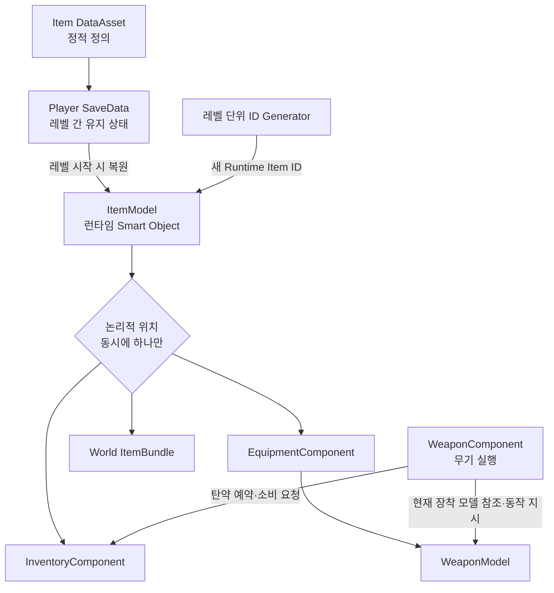
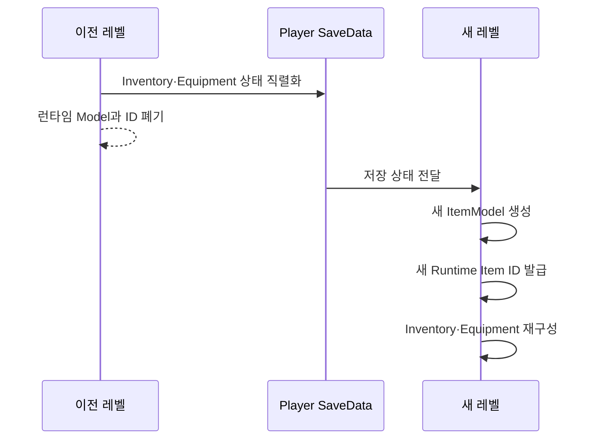
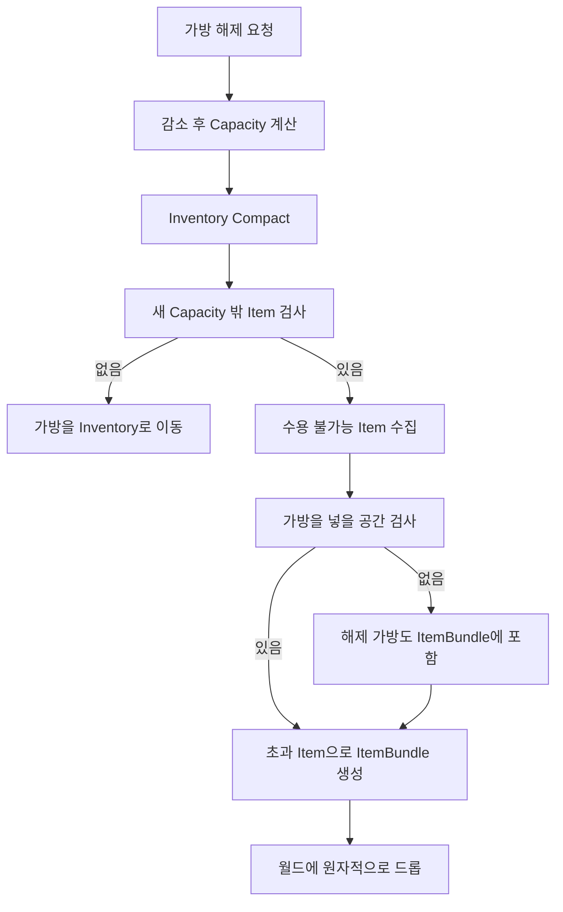

# 장비와 인벤토리

> 최종 갱신: 2026-08-28



## 상태

| 항목 | 상태 | 비고 |
|---|---|---|
| Item·Equipment·Inventory 책임 | 설계 확정 | 구현 전 |
| Item DataAsset 공통 필드 | 설계 확정 | 실제 클래스명·세부 타입은 구현 시 확인 |
| Inventory 슬롯·Capacity | 설계 확정 | 최대 49, 기본 21 |
| 장비 획득·교체·해제 | 설계 확정 | 원자적 이동 필요 |
| 탄약 Reservation | 설계 확정 | Stack과 분리 |
| Runtime Item ID | 설계 확정 | 레벨 경계에서 재발급 |
| ID Generator 구현 위치 | 미정 | GameState·Subsystem 등 수명주기 검토 필요 |
| 탄약 Category의 실제 Enum 이름 | 미정 | 문서 용어는 `Ammunition` 사용 |
| 선호·Reserved 탄 UI 표현 | 일부 미정 | 대표 Stack과 표시 방식 추후 결정 |

## 기본 원칙

Item은 플레이어 또는 다른 Entity가 획득·소유·보관·이전할 수 있는 객체다. 하나의 ItemModel은 동시에 `World`, `Inventory`, `Equipment`, `ItemBundle`, 다른 Entity 중 한 장소에만 존재한다. UI는 Model을 소유하거나 직접 수정하지 않고 요청과 표시만 담당한다.

```text
DataAsset = Item 종류의 정적 정의
ItemModel = 현재 레벨에 존재하는 런타임 상태와 자기 상태 규칙
SaveData = 플레이어가 레벨을 넘어 유지해야 하는 직렬화 데이터
```

Model은 단순 데이터 구조가 아니라 자기 상태를 판단하는 Smart Object다. 예를 들어 WeaponModel은 `CanFire`, `CanReload`, `CanUseAmmo`, 내구도 변경과 등록 탄약 상태를 판단할 수 있다. 다만 HUD 변경, Inventory 검색, 월드 Actor 생성처럼 다른 시스템을 조율하지 않는다.

> Model은 자기 상태를 알고 판단한다. Component는 여러 Model과 시스템 사이의 행동을 조율한다.

## 아이템 분류와 품질

```text
Item
├─ Equipment
│  ├─ Weapon
│  ├─ Armor
│  ├─ Bag
│  └─ Accessory
├─ Ammunition
├─ Ingredient
├─ QuestItem
└─ Miscellaneous
```

붙여넣은 초안의 `Projectile` Category는 월드의 Projectile Actor와 혼동될 수 있으므로 문서에서는 `Ammunition`을 사용한다. 실제 `EItemCategory` 열거자 이름은 코드 설계 시 확정한다.

`Consumable`과 `Craftable`은 Item 종류가 아니라 중복 가능한 속성이다. 분류 Enum과 Model 상속 구조도 반드시 1:1로 맞추지 않는다. 단순히 DataAsset과 Quantity만 필요한 종류는 별도 Model 클래스를 만들지 않으며, 특수 런타임 상태와 규칙이 필요한 경우에만 파생 Model을 추가한다.

현재 품질 단계:

```text
EItemQuality
├─ Normal
├─ Rare
├─ Unique
└─ Relic
```

## Item DataAsset 공통 데이터

ItemModel은 Item 종류의 정적 정의를 가진 DataAsset을 참조한다. C++ 클래스명은 구현 시 확정하며, 에셋 인스턴스는 `DA_*` 네이밍을 사용할 수 있다.

```text
EItemCategory Category
EItemQuality Quality
int32 MaxStackSize = 1
float Weight
bool bConsumable
bool bCanBeCraftingMaterial
bool bDismantleable
```

`bStackable`은 별도로 저장하지 않는다.

```text
MaxStackSize <= 1 → 스택 불가능
MaxStackSize > 1  → 스택 가능
```

다른 값에서 확실하게 유도할 수 있는 Bool을 중복 저장하지 않아 데이터 모순을 방지한다. 필요하면 `IsStackable()` 편의 함수로 제공한다.

`Weight`는 아이템 한 개의 무게이며 스택의 총무게는 `Weight × Quantity`다. 무게 시스템은 현재 우선순위가 아니므로 DataAsset 속성만 준비하고 로직은 구현하지 않는다. 향후 소지 중량, 과적, 이동 속도·스태미나, 가방 제한과 UI 총중량에 사용할 수 있다.

`bCrafted`는 정적 DataAsset에 추가하지 않는다. 제작 여부는 개별 ItemModel의 생성 이력이므로 필요할 때 `EItemAcquisitionSource` 같은 런타임·SaveData 정보로 확장하며 정확한 값은 그때 확정한다.

## ItemModel과 EquipmentModel

```text
UItemModel
├─ RuntimeItemId
├─ ItemDataAsset
├─ Quantity
└─ 종류별 런타임 상태
```

스택 불가능한 ItemModel은 `Quantity = 1`을 유지한다. 현재 WeaponModel은 향후 다음 ItemModel 계층에 편입한다.

```text
UItemModel
└─ UEquipmentModel
   ├─ UWeaponModel
   ├─ UArmorModel       필요 시
   ├─ UBagModel         필요 시
   └─ UAccessoryModel   필요 시
```

Armor·Bag·Accessory에 별도 런타임 상태가 필요하지 않다면 파생 클래스를 미리 만들지 않는다.

Model이 직접 HUD를 변경하거나 Inventory·Equipment Component를 검색하고 World Actor를 생성하는 것은 금지한다.

## 런타임 ID와 레벨 전환

Item ID는 세이브를 넘어 유지되는 GUID가 아니라 현재 레벨/런타임에서 ItemModel을 식별하는 고유 번호다. 플레이어 소유 아이템은 레벨 전환 전에 SaveData로 직렬화하고, 새 레벨에서 새로운 ItemModel과 Runtime Item ID를 부여받는다.



이전 레벨의 ID와 새 레벨의 ID가 달라도 같은 저장 상태를 복원한 것으로 본다. 바닥에 놓인 월드 아이템은 레벨 종료와 함께 삭제하며, 모든 월드 아이템을 영속 추적하는 글로벌 Registry는 두지 않는다. ID Generator의 실제 소유 위치는 아직 정하지 않았다.

ItemModel UObject 자체를 SaveGame에 그대로 저장하지 않고 별도 SaveData Struct로 직렬화한다.

```text
WeaponModel → FWeaponSaveData
FWeaponSaveData → CreateWeaponModel → 새 WeaponModel
```

SaveData에는 복원해야 하는 인스턴스 상태와 정적 DataAsset Definition을 찾을 식별 정보를 저장한다. 이전 Runtime Item ID는 저장하지 않는다.

## Component 책임

| Component | 책임 |
|---|---|
| InventoryComponent | ItemModel·Slot·Capacity, Stack Merge/Split, Compact/Sort, Ammo Total/Reserved/Available, 이동 조건 검증 |
| EquipmentComponent | 장비 Slot, Equip/Unequip/Swap, Auto Equip 정책, 현재 장착 ItemModel 제공 |
| WeaponComponent | 현재 WeaponModel 사용, Fire/Reload/Aim/Weapon Change 조율, Inventory에 탄약 탐색·Reservation·Consume 요청 |

현재 C++에서는 WeaponComponent가 WeaponModel을 생성·보관하고 탄약을 직접 관리한다. 이는 Inventory·Equipment 구현 전 임시 구조다. 목표 구조에서는 EquipmentComponent가 현재 WeaponModel을 제공하고 WeaponComponent는 무기 사용만 조율한다.

## InventoryComponent

- UI 그리드: `7 × 7`, 최대 49칸
- 기본 Capacity: 21칸
- 모든 ItemModel: 1칸 사용
- 가방과 옵션: 자유로운 정수 Capacity Modifier 적용
- 최종 Capacity 밖 슬롯: 잠금
- Item Stack, Compact, Sort와 탄약 Reservation 관리

```text
FinalCapacity = Clamp(BaseCapacity + BagModifier + OtherModifiers, 0, 49)
```

`CompactInventory`는 빈칸을 앞으로 당기고, `SortInventory`는 종류·희귀도·이름 같은 기준으로 순서를 바꾼다. 두 기능은 분리하며 가방 해제에는 Compact를 먼저 사용한다.

모든 Item은 `1 × 1`이며 아이템별 크기 개념은 사용하지 않는다. Capacity는 행 단위가 아니라 자유로운 Slot 수다. 예를 들어 최종 Capacity가 30이면 `0~29`는 사용 가능하고 `30~48`은 Locked 상태로 표시한다.

## EquipmentComponent

장비 슬롯은 다음과 같다.

- Head
- Body
- Gloves
- Shoes
- Weapon 1 / Weapon 2
- Accessory 1 / Accessory 2
- Bag

EquipmentComponent는 장착된 ItemModel과 슬롯 상태를 관리한다. 목표 구조에서 WeaponComponent는 WeaponModel을 직접 소유하지 않고 EquipmentComponent가 가진 현재 WeaponModel을 참조해 무기 행동을 실행한다.

현재 자동 장착 정책은 모든 장비에 적용한다. 빈 호환 장비 슬롯이 있으면 바로 장착하고, 없으면 Inventory로 이동한다. 추후 `AllEquipment`, `WeaponOnly`, `Disabled` 같은 정책으로 변경할 수 있게 분리한다.

기존 슬롯에 새 장비를 장착하면 새 장비가 있던 Inventory 슬롯과 기존 장비를 Swap한다. 호환 장비 슬롯과 Inventory가 모두 가득 찼다면 획득을 실패시키고 월드 아이템을 유지한다.

```text
일반 Item
Pickup → Inventory 빈 Slot 탐색 → 이동 또는 실패

Equipment
Pickup → Auto Equip 검사
       → 호환 빈 Equipment Slot이 있으면 바로 장착
       → 없으면 Inventory로 이동
```

기존 장비와 Inventory 장비를 Swap할 때는 새 장비가 있던 Slot에 기존 장비를 돌려놓으므로 별도의 빈 Inventory Slot을 요구하지 않는다. 일반 장비 해제는 Inventory에 빈 Slot이 없으면 실패한다. 가방 해제와 더 작은 가방으로의 교체는 Capacity가 바뀌므로 별도 절차를 따른다.

## 가방 해제와 Capacity 감소



아이템 이동은 `검증 → Transfer → 완료`의 원자적 작업으로 처리한다. 중간 실패 때문에 ItemModel이 복제되거나 사라져서는 안 된다.

잠길 Slot에 있던 Item을 무조건 버리지 않는다. Compact 이후 새 Capacity 안에 들어오는 Item은 유지한다.

여러 Item이 동시에 바닥에 떨어질 때 각각 World Actor를 만들지 않고 하나의 `AItemBundle`이 여러 ItemModel을 보관한다. 플레이어는 상호작용하여 ItemBundle Inventory UI를 열 수 있다.

```text
AItemBundle
├─ WeaponModel
├─ ArmorModel
├─ Ammunition ItemModel
└─ BagModel
```

## 아이템 이동 Transaction

가능한 이동 경로:

```text
World → Inventory
World → Equipment
Inventory ↔ Equipment
Inventory → ItemBundle
ItemBundle → Inventory
Entity A → Entity B
```

아이템 이동은 중간 실패로 Item이 복제되거나 소실되지 않도록 하나의 Transaction처럼 처리한다.

```text
CanTransfer?
→ 전체 조건 검증
→ Transfer
→ 완료
```

후보 API는 `TryPickupItem`, `TryMoveItem`, `TryEquipItem`, `TryUnequipItem`, `TrySwapItem`, `TryDropItem`이다. 정확한 이름과 Transaction 구현 방식은 C++ 구조 설계 시 확정한다.

## 탄약과 Projectile 구분

- Ammunition Item: Inventory에 소유·보관되는 탄약
- Projectile Actor: 발사 후 월드에서 이동·충돌하는 실행 객체
- Projectile Data: 발사체의 정적 비행·충돌 정의

같은 구경에 여러 탄종이 존재할 수 있지만 한 번의 장전에는 한 탄종만 사용한다. 서로 다른 탄종을 합쳐 탄창을 채우는 혼합 장전은 허용하지 않는다.

```text
30발 무기
Inventory: AP × 10, Normal × 20
AP 선택 → AP 10발만 등록
```

## 탄약 Reservation

장전은 Ammunition Item을 WeaponModel로 이동시키는 작업이 아니라 Inventory가 가진 탄약의 사용 권한을 등록하는 작업이다.

```text
Inventory: TotalAmmo / ReservedAmmo / AvailableAmmo
WeaponModel: RegisteredAmmoType / RegisteredAmmoCount

AvailableAmmo = TotalAmmo - ReservedAmmo
```

발사 성공 시 Inventory의 Total/Reserved와 WeaponModel의 Registered 수량을 함께 1발 감소시킨다. 버리기·이전에는 Available 수량만 사용할 수 있다. WeaponModel은 특정 Stack ID를 기억하지 않고 탄종과 등록 수량만 안다. 따라서 Stack Split, Merge, Sort가 무기 시스템과 결합되지 않는다.

```text
장전: Total 30 / Reserved 30 / Available 0
발사: Total 29 / Reserved 29 / Weapon Registered 29
```

여러 Stack에 같은 탄종이 있어도 WeaponModel은 “Stack A에서 4발, Stack B에서 6발” 같은 배분 정보를 기억하지 않는다. Reservation은 탄종 단위로 관리하여 Compact와 Sort도 무기 시스템에서 분리한다.

## 재장전 탄종 선택

호환 탄종이 하나면 자동 선택한다. 여러 탄종이 있으면 다음 순서로 결정한다.

1. 플레이어가 저장한 선호 탄종
2. 희귀도가 가장 낮은 탄종
3. WeaponModel의 마지막 사용 탄종
4. 결과를 항상 동일하게 만드는 고정 기준

희귀도가 낮은 탄을 마지막 사용 탄보다 우선하는 이유는 플레이어가 귀한 탄을 의도하지 않게 소비하는 불쾌한 경험을 막기 위해서다.

선호 탄은 특정 Stack이 아니라 탄종 Definition으로 SaveData에 저장한다. 해당 탄이 0개가 되어도 설정은 유지하며 다시 획득하면 선호 탄으로 인식한다.

```text
PreferredAmmo
5.56 → DA_556_AP
9mm → DA_9mm_Normal
```

## 탄약 UI 미정 사항

같은 탄종을 여러 Stack으로 나눌 수 있으므로 탄종이 같다는 이유만으로 모든 Stack에 Glow를 표시하지 않는다. 선호 탄종 데이터와 UI에서 강조할 대표 Stack은 별개다. 대표 Stack 선정 규칙은 아직 정하지 않았다.

Reserved 상태도 Stack과 분리되어 있으므로 특정 Stack Glow로 표현한다고 가정하지 않는다. 탄종 전체 표시, 대표 Stack 하나, 별도 아이콘·수량 표시 중 어떤 방식을 사용할지는 UI 구현 단계에서 정한다.

대표 Stack을 첫 번째 Stack, Quantity가 가장 큰 Stack, 플레이어가 직접 지정한 Stack 중 무엇으로 정할지도 미확정이다.

## UI와 월드 상호작용

장비창과 Inventory UI는 Component 상태를 표시하고 Drag & Drop 또는 메뉴 요청을 전달한다. 실제 ItemModel 위치와 Slot 상태를 UI가 소유하지 않는다.

```text
플레이어가 World Item에 접근
→ Interaction 가능 상태
→ HUD에 입력 안내
→ 획득 요청
→ Auto Equip 또는 Inventory 이동
```

HUD는 상호작용 가능 여부, 입력 안내와 “인벤토리가 가득 찼습니다” 같은 실패 알림만 담당한다.

## 구현 후보와 순서

핵심 클래스 후보:

```text
UItemModel
UEquipmentModel
UWeaponModel
UInventoryComponent
UEquipmentComponent
UWeaponComponent
UItemDataAsset
UEquipmentDataAsset
UWeaponDataAsset
Item SaveData Struct
Weapon SaveData Struct
AWorldItem
AItemBundle
```

`UArmorModel`, `UBagModel`, `UAccessoryModel`, `UAmmoModel`은 실제 특수 런타임 상태와 로직이 필요할 때 추가한다.

구현 우선순위:

1. Item DataAsset 공통 정의
2. `UItemModel`: Runtime ID, DataAsset 참조, Quantity, 공통 API
3. `UEquipmentModel`과 기존 `UWeaponModel` 편입
4. `UInventoryComponent`: 49 Slot, Capacity, Stack, Compact, Sort
5. `UEquipmentComponent`: Slot, Equip, Unequip, Swap, Auto Equip
6. WeaponComponent와 EquipmentComponent 연결
7. Ammo Reservation
8. Item Transfer Transaction
9. SaveData·Load·Level Transition
10. WorldItem·ItemBundle
11. Inventory·Equipment UI

구현 시 `UObject Outer`, `UPROPERTY/TObjectPtr`, Garbage Collection, UObject 생성 위치, ID Generator 수명, SaveGame 직렬화, DataAsset Reference 저장 방식과 레벨 전환 재구성을 함께 검토한다.

## 구현 원칙 요약

1. 정적 정보는 DataAsset에 둔다.
2. 런타임 개별 상태는 ItemModel에 둔다.
3. 레벨 간 유지 상태는 별도 SaveData에 둔다.
4. Model은 Smart Object지만 다른 시스템을 직접 찾아 제어하지 않는다.
5. Component가 Model과 시스템 사이의 상호작용을 조율한다.
6. 하나의 ItemModel은 논리적으로 한 장소에만 존재한다.
7. Item 이동은 소실 방지를 위해 Transaction 형태로 처리한다.
8. 다른 값에서 확실하게 유도되는 Bool은 저장하지 않는다.
9. Runtime Item ID는 레벨 단위이며 SaveData에 유지하지 않는다.
10. UI 표현을 위해 핵심 시스템 데이터를 왜곡하지 않는다.

---

## 상위 페이지

- [03_시스템 설계](03_%EC%8B%9C%EC%8A%A4%ED%85%9C%20%EC%84%A4%EA%B3%84.md)

## 관련

- [Item](객체%20설계/Item.md)
- [무기 시스템](%EB%AC%B4%EA%B8%B0%20%EC%8B%9C%EC%8A%A4%ED%85%9C.md)
- [게임 객체 분류](../02_%EA%B2%8C%EC%9E%84%20%EA%B8%B0%ED%9A%8D/%EA%B2%8C%EC%9E%84%20%EA%B0%9D%EC%B2%B4%20%EB%B6%84%EB%A5%98.md)
- [Player](%EA%B0%9D%EC%B2%B4%20%EC%84%A4%EA%B3%84/Player.md)
- [남은 이슈](../01_%EC%9D%BC%EC%A0%95%20%EA%B4%80%EB%A6%AC/%EB%82%A8%EC%9D%80%20%EC%9D%B4%EC%8A%88.md)
