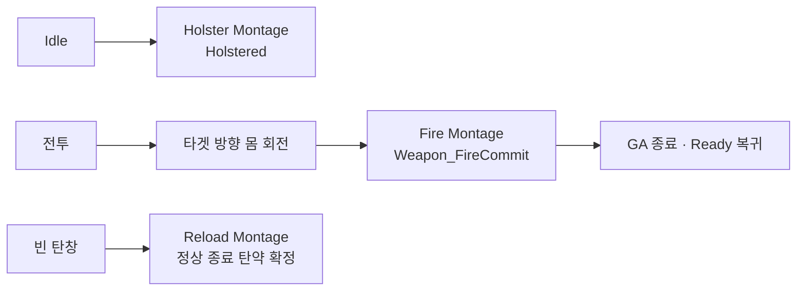

# NPC 행동

## 설계 의도

## 상태

- 2026-10-08 대화·C++ 기준 갱신
- 사격·재장전 동작 사용자 확인. 개별 AnimBP Slot·몽타주 에셋 설정은 Editor 확인 대상
- HitReaction 상태·피격 방향 Task 미구성 사용자 확인

## 평상시

- Idle 진입 시 기존 RequestWeaponHolster 경로 사용
- Upper의 Holstering→Holstered에서 수납 표현
- 순찰 이동은 Base Blueprint Task와 Controller API 사용

## 전투

- Player·NPC의 공통 WeaponDataAsset.FireMontage 사용 가능
- C++ AttackSequenceHandler에서 Montage 재생. Blueprint의 별도 Play Montage 중복 호출 제외
- NPC AnimBP에 Montage와 같은 Slot 연결. Skeleton 호환 확인
- Montage Notify `Weapon_FireCommit`에서 실제 공격 확정
- NPCCharacter의 몸 회전 완료 후 발사 요청
- Reload Montage 정상 종료 시 탄약 확정. 중단·취소 시 변경 없음
- Ready Task는 손 부착 성공 후 ReadyEntered 발행·Running 유지

## 기절·사망·파손·도주

- 피격 방향 회전용 BeginDamageLook·UpdateDamageLook·EndDamageLook C++ 반영
- 피격 몽타주와 방향 확인 Task가 함께 있으면 두 작업 완료 후 상태 이탈
- 현재 HitReaction 상태 미구성. 애셋·전이 연결은 후속
- 사망은 설정된 DeathMontage 종료 Delegate에서 LootBox 스폰·Pawn Destroy
- Montage 누락·재생 실패 시 동일 정리 경로. 사망 시각 연출 완료 여부 미확인

## 상호작용

## 문서 연결

- 기획: [NPC 행동](../../02_%EA%B2%8C%EC%9E%84%20%EA%B8%B0%ED%9A%8D/%EC%8B%9C%EC%8A%A4%ED%85%9C%20%EA%B8%B0%ED%9A%8D/NPC%20%ED%96%89%EB%8F%99.md)
- 시스템 설계: [NPC 행동](../../03_%EC%8B%9C%EC%8A%A4%ED%85%9C%20%EC%84%A4%EA%B3%84/NPC%20%ED%96%89%EB%8F%99.md)
- 애니메이션 설계: [NPC 행동](NPC%20%ED%96%89%EB%8F%99.md)
