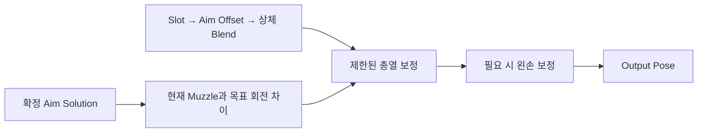

# 무기 조준·반동·명중률

## 설계 의도

논리적 탄도와 시각 포즈를 분리

완성된 애니메이션의 손·팔 관계 유지



## 논리적 발사 방향과 시각 정렬

카메라 Trace가 정한 목표와 실제 총열 방향을 분리

```text
Camera Trace → AimTarget
ShotDirection = Normalize(AimTarget - MuzzleLocation)
DesiredMuzzleRotation = MakeRotFromX(ShotDirection)
```

- 논리적 발사 방향: Muzzle에서 AimTarget 또는 TraceEnd로 향하는 방향
- 시각적 총열 방향: 현재 애니메이션 Pose의 Muzzle Forward
- 시각 보정: 두 방향의 차이를 Control Rig으로 제한 적용

### 두 오차의 구분

```text
Parallax Error
= DesiredMuzzleRotation - CameraDirectionRotation

Visual Muzzle Correction
= DesiredMuzzleRotation - CurrentMuzzleRotation
```

`Camera Forward Vector → Make Rot from X`를 사용하면 Roll을 제거하고 Desired 방향과 같은 “방향 벡터 기반 회전”으로 비교 가능

Parallax Error는 TPS 카메라와 총구 위치 차이에 따른 수렴각이며 실제 Control Rig 보정량이 아니다

측정된 Parallax:

| 조건 | Pitch | Yaw | 해석 |
|---|---:|---:|---|
| 근거리 | 0.77° | 0.69° | 작은 수렴각 |
| 초근접·지면 | 7.32° | 3.24° | 카메라와 총구 시차가 급격히 증가 |
| 약 20~30m | 0.70° | 0.36° | 거의 평행에 가까움 |
| 유효 사거리 밖·하늘 | 1.10° | 0.41° | TraceEnd 기준 수렴각 |

다음 측정은 `DesiredMuzzleRotation - CurrentMuzzleRotation`의 Pitch/Yaw다

이 값이 실제 Control Rig 입력

### 시각 정렬 정책

```text
Camera Trace Blocking Hit 있음
→ AimTarget = ImpactPoint
→ 논리 발사 방향 사용
→ 시각 총열 정렬 활성화

Blocking Hit 없음
→ AimTarget = TraceEnd
→ 논리 발사 방향은 계속 사용
→ 유효 사거리 밖 시각 정렬 비활성화
```

현재는 최대 Pitch/Yaw를 각각 `30°`로 제한한 상태에서 평사·상향·하향 조준을 검증했다

이후 다른 무기나 초근접 자세에서 팔과 손목 꺾임이 확인될 때만 최소 시각 정렬 거리 또는 무기별 최대 보정각을 추가

### 현재 검증 결과

`MaxVisualAimCorrectionYaw/Pitch`를 `30°`로 설정하고 Yaw 보간의 Target을 `TargetVisualAimCorrectionYaw`에 연결한 뒤 다음을 확인했다

- 평상시 조준에서 실제 총열 방향과 발사 방향이 일치
- 위·아래 조준에서도 두 방향이 일치
- 조준 보정 해제 시 Yaw/Pitch 값이 0으로 복귀
- Fire Montage 중 반동 애니메이션으로 총열선이 일시적으로 벗어나지만 탄환은 확정된 사격 방향으로 정상 발사
- Montage 종료 후 총열과 발사 방향이 다시 일치

따라서 총열 시각 보정은 완료 상태다

`30°`는 비정상 입력을 막는 안전 한계로 유지하고 무기별 최종 튜닝값은 향후 조정 가능

현재 스켈레톤에서는 앞뒤 숙임이 `Transform (Modify) Bone`의 Roll 축에 대응하므로 Pitch 보정값을 해당 축에 부호 조절하여 적용

## AimOffset과 왼손

AimOffset에서 Pitch 절대값이 커질수록 왼손과 팔이 분리되던 문제는 완료 상태다

원인은 이미 완성된 무기 애니메이션에 FABRIK을 추가하여, 애니메이션이 가진 손·팔 관계를 다시 강제로 보정한 것이었다

- 완성된 무기 애니메이션은 기존 손·팔 포즈를 기준으로 사용
- 해당 경로에는 불필요한 FABRIK을 중복 적용하지 않음
- FABRIK은 절차적 왼손 고정이 실제로 필요한 무기·상태에서만 별도 검증 후 사용
- AimOffset 샘플은 `Mesh Space Additive`와 동일 Base Pose를 유지

따라서 이 문제의 해결 기준은 FABRIK 수치 튜닝이 아니라, 완성된 애니메이션 위에 중복된 절차적 보정을 제거하는 것


## 반동

- Fire Montage의 반동 표현과 실제 ShotDirection 분리
- Montage 중 일시적인 총열 이탈: 정상 표현
- Montage 종료 후 목표 방향으로 복귀
- 카메라 반동 누적·회복: [무기 조준·반동·명중률](../../03_%EC%8B%9C%EC%8A%A4%ED%85%9C%20%EC%84%A4%EA%B3%84/%EB%AC%B4%EA%B8%B0%20%EC%A1%B0%EC%A4%80%C2%B7%EB%B0%98%EB%8F%99%C2%B7%EB%AA%85%EC%A4%91%EB%A5%A0.md)

## 명중률

- 탄 퍼짐 계산·발사 적용: [무기 조준·반동·명중률](../../03_%EC%8B%9C%EC%8A%A4%ED%85%9C%20%EC%84%A4%EA%B3%84/%EB%AC%B4%EA%B8%B0%20%EC%A1%B0%EC%A4%80%C2%B7%EB%B0%98%EB%8F%99%C2%B7%EB%AA%85%EC%A4%91%EB%A5%A0.md)
- 명중률에 따른 별도 애니메이션 변화:

## 문서 연결

- 기획: [무기 조준·반동·명중률](../../02_%EA%B2%8C%EC%9E%84%20%EA%B8%B0%ED%9A%8D/%EC%8B%9C%EC%8A%A4%ED%85%9C%20%EA%B8%B0%ED%9A%8D/%EB%AC%B4%EA%B8%B0%20%EC%A1%B0%EC%A4%80%C2%B7%EB%B0%98%EB%8F%99%C2%B7%EB%AA%85%EC%A4%91%EB%A5%A0.md)
- 시스템 설계: [무기 조준·반동·명중률](../../03_%EC%8B%9C%EC%8A%A4%ED%85%9C%20%EC%84%A4%EA%B3%84/%EB%AC%B4%EA%B8%B0%20%EC%A1%B0%EC%A4%80%C2%B7%EB%B0%98%EB%8F%99%C2%B7%EB%AA%85%EC%A4%91%EB%A5%A0.md)
- 애니메이션 설계: [무기 조준·반동·명중률](%EB%AC%B4%EA%B8%B0%20%EC%A1%B0%EC%A4%80%C2%B7%EB%B0%98%EB%8F%99%C2%B7%EB%AA%85%EC%A4%91%EB%A5%A0.md)
