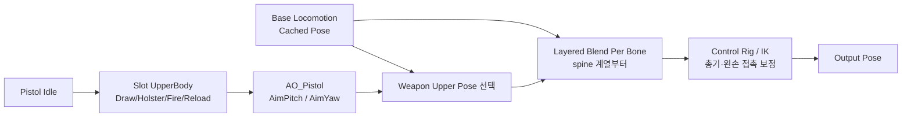

# 무기



## 설계 의도

## 1. 현재 구성

주요 AnimBP:

`Content/Characters/Mannequins/Anims/Unarmed/ABP_Unarmed.uasset`

권총 애니메이션:

`Content/Astra/Entity/Animations/Pistol`

권총 행동 애니메이션은 Weapon Item의 소유물이 아니라 무기를 사용하는 Humanoid Entity의 표현

장기 콘텐츠 분류는 `Content/Astra/Entity/Humanoid/Animations`를 기준으로 하며, 현재 경로 이동은 참조 검증과 Redirector 정리를 거쳐 별도 수행

현재 구성 요소:

- 기본 Locomotion / Main States
- `FinalBasePose` Cached Pose
- Pistol Idle 상체 포즈
- `UpperBody` Montage Slot
- Layered Blend Per Bone
- `AO_Pistol` Aim Offset
- Control Rig

## 2. 권장 AnimGraph 순서


현재 권총 구성에서는 `UpperBody Slot → Aim Offset → Weapon Upper Pose 선택 → Layered Blend Per Bone` 순서를 사용

Slot을 Aim Offset 뒤에 두면 Fire Montage가 고정된 팔·어깨 포즈로 돌아가 카메라 조준 Pitch를 무시하는 문제가 확인됨

Draw/Holster처럼 Aim Offset이 필요 없는 구간은 Aim 입력을 0으로 보간하거나 해당 분기에서 적용을 끕니다

IK를 너무 앞에 두면 뒤의 Montage나 Blend가 손 위치를 다시 움직이므로 최종 접촉 보정은 가능한 한 뒤쪽에 둠

## 3. UpperBody Slot

Slot은 Skeletal Mesh에서 Montage를 만드는 기능이 아닙니다

1. Skeleton 에셋의 Anim Slot Manager에서 `UpperBody` Slot을 생성
2. Equip/Holster/Fire/Reload Montage의 Slot Track을 `DefaultGroup.UpperBody`로 변경
3. AnimBP AnimGraph에 `Slot 'UpperBody'` 노드를 추가
4. Slot 결과를 Layered Blend Per Bone의 상체 Blend Pose에 연결

Layered Blend Per Bone의 시작 뼈는 Skeleton에 맞는 `spine_01` 또는 상응하는 척추 뼈를 사용하고 Mesh Space Rotation Blend를 비교 테스트

## 4. Draw/Holster 연결

현재 Montage:

- `MM_Pistol_Equip_Montage`
- `MM_Pistol_Holster_Montage`

권총은 `EquipMontage = None`으로 두고 몸이 전투 방향에 정렬된 뒤 즉시 손에 부착하는 구성을 사용

Draw 상태와 Pending Action은 유지하며, 다른 무기는 필요할 때 같은 구조에서 선택적으로 Equip Montage를 사용 가능

Holster는 역재생 설정을 DataAsset 코드에서 강제하지 않음

별도 Holster Montage 에셋의 재생 방향과 구간을 에디터에서 설정하고 `WeaponDataAsset.HolsterMontage`에 연결

Pistol Idle과 Montage가 섞여 손이 어긋나는 경우:

- Montage Slot이 `UpperBody`인지 확인
- Montage Blend In/Out을 짧게 조정
- Holstering 중에는 지속 Pistol Idle 포즈의 적용 조건을 구분
- Attach Notify가 손이 실제로 무기를 놓는 프레임에 있는지 확인

- 이전 조치: Blend In/Out 조정·Fire 후반 프레임 기반 MM_Pistol_NewIdle 생성
- 현재 상태: ANIM-002 해결 완료
- 완료 기준: Idle 루프와 Idle↔Fire 전환의 팔·어깨·총기 단절 해소
- 근거: [해결된 이슈 — ANIM-002](../../01_일정%20관리/해결된%20이슈.md#anim-002-pistol-idle과-fire-포즈-불일치-및-idle-루프-끊김)

## 5. Aim Pitch 계산

카메라와 캐릭터의 상대 회전을 사용

```text
DeltaRotation = NormalizedDeltaRotator(BaseAimRotation, ActorRotation)
TargetAimPitch = Clamp(DeltaRotation.Pitch, -70, 70)
AimPitch = FInterpTo(AimPitch, TargetAimPitch, DeltaTime, AimInterpSpeed)
```

AnimBP EventGraph에서 계산하되 `Character`가 유효한 경우에만 수행

비활성 상태에서는 `AimPitch`를 0으로 보간해 자연스럽게 복귀시킵니다

## 6. Aim Offset

`AO_Pistol`은 입력 단위가 도(degree)

축 Min/Max가 `-1, 1`이면 마우스를 조금만 움직여도 끝 샘플로 즉시 이동해 뚝뚝 끊겨 보

현재 해결:

- Aim Offset 축 범위를 실제 샘플 각도에 맞게 확대
- Pitch 입력을 해당 범위의 도 단위로 전달
- EventGraph에서 `FInterpTo` 적용

카메라는 ±70도로 제한하되, 원본 Aim 샘플이 ±90도라면 Aim Offset 에셋의 축과 샘플 위치는 ±90도를 유지하고 **입력값만 ±70도로 Clamp** 가능

Center/Up/Down 샘플은 모두 `Mesh Space Additive`와 동일한 Base Pose를 사용 필요

`Preview Base Pose`는 에디터 미리보기 설정이며 각 Animation Sequence의 Additive Base 설정을 대신하지 않음

AimOffset 왼손 이탈: 완료

- 원인: 완성된 애니메이션 위에 중복 적용한 FABRIK
- 해결: 해당 경로의 중복 FABRIK 제거
- 상세: [무기 조준·반동·명중률](%EB%AC%B4%EA%B8%B0%20%EC%A1%B0%EC%A4%80%C2%B7%EB%B0%98%EB%8F%99%C2%B7%EB%AA%85%EC%A4%91%EB%A5%A0.md)

## 7. 카메라 Pitch 제한

- PlayerCameraManager 설정: [플레이어](../../03_%EC%8B%9C%EC%8A%A4%ED%85%9C%20%EC%84%A4%EA%B3%84/%EA%B0%9D%EC%B2%B4%20%EC%84%A4%EA%B3%84/%ED%94%8C%EB%A0%88%EC%9D%B4%EC%96%B4.md)
- Aim Offset 입력 Clamp와 카메라 View 제한 구분

## 8. 총기 방향 보정

- [무기 조준·반동·명중률](%EB%AC%B4%EA%B8%B0%20%EC%A1%B0%EC%A4%80%C2%B7%EB%B0%98%EB%8F%99%C2%B7%EB%AA%85%EC%A4%91%EB%A5%A0.md)

## 9. 왼손 고정

AimOffset 왼손 이탈 문제는 완료됨

원인은 완성된 무기 애니메이션 위에 FABRIK을 추가하여 기존 손·팔 관계를 다시 보정한 것이었습니다

완성된 애니메이션 경로에서는 중복 FABRIK을 제거하고, 절차적 왼손 고정이 필요한 별도 무기·상태에서만 FABRIK을 사용

### 에디터 작업

1. 권총 Static Mesh 에디터에서 `LeftHandGrip` Socket 생성
2. 권총을 오른손에 붙인 상태로 소켓 위치를 왼손 손바닥 중심에 맞춤
3. Aim Offset으로 큰 상체 방향을 먼저 구성
4. Control Rig에서 현재 Muzzle과 Desired Muzzle의 잔여 오차 계산
5. 오른손과 총열을 먼저 보정
6. 같은 Rig 평가 안에서 변경된 무기 위치의 LeftHandGrip을 기준으로 왼손 보정
7. Draw/Holster 중에는 보정을 끄거나 상태 기반으로 보간

오른손이 무기의 기준이므로 절차적 왼손 IK가 필요한 경우에는 오른손/무기 보정 이후에 적용

다만 완성된 무기 애니메이션에는 FABRIK을 중복 적용하지 않음

향후 다른 무기에서 절차적 왼손 고정이 필요하면 해당 애니메이션 구성과 함께 별도로 검증

## 10. 카메라 구성

- 시스템 책임·생명주기: [플레이어](../../03_%EC%8B%9C%EC%8A%A4%ED%85%9C%20%EC%84%A4%EA%B3%84/%EA%B0%9D%EC%B2%B4%20%EC%84%A4%EA%B3%84/%ED%94%8C%EB%A0%88%EC%9D%B4%EC%96%B4.md)
- [PlayerCameraManager 참조 구성](../../08_%EA%B8%B0%EC%88%A0%20%EC%9C%84%ED%82%A4_%EA%B3%B5%ED%86%B5%20%EA%B0%80%EC%9D%B4%EB%93%9C/Unreal/Gameplay%20Framework/PlayerCameraManager%20%EC%B0%B8%EC%A1%B0%20%EA%B5%AC%EC%84%B1.md)

## 상위 페이지

- [04_아트 및 애니메이션](../04_%EC%95%84%ED%8A%B8%20%EB%B0%8F%20%EC%95%A0%EB%8B%88%EB%A9%94%EC%9D%B4%EC%85%98.md)

## 관련

- [무기 시스템](../../03_%EC%8B%9C%EC%8A%A4%ED%85%9C%20%EC%84%A4%EA%B3%84/%EB%AC%B4%EA%B8%B0.md)
- [무기 조준·반동·명중률](../../03_%EC%8B%9C%EC%8A%A4%ED%85%9C%20%EC%84%A4%EA%B3%84/%EB%AC%B4%EA%B8%B0%20%EC%A1%B0%EC%A4%80%C2%B7%EB%B0%98%EB%8F%99%C2%B7%EB%AA%85%EC%A4%91%EB%A5%A0.md)
- [게임 객체 분류](../../02_%EA%B2%8C%EC%9E%84%20%EA%B8%B0%ED%9A%8D/%EA%B2%8C%EC%9E%84%20%EA%B0%9D%EC%B2%B4%20%EB%B6%84%EB%A5%98.md)
- [로코모션과 파쿠르](../../03_%EC%8B%9C%EC%8A%A4%ED%85%9C%20%EC%84%A4%EA%B3%84/%EC%9D%B4%EB%8F%99%EA%B3%BC%20%ED%8C%8C%EC%BF%A0%EB%A5%B4.md)

## 소켓·부착

### 캐릭터 Skeleton

- `WeaponSocket_R`: 오른손 장착
- `PistolHolsterSocket`: 권총 수납

### 무기 Static Mesh

- `Muzzle`: Projectile과 Muzzle VFX 시작점
- `LeftHandGrip`: 총열 Control Rig 적용 후 왼손 최종 보정 목표로 사용 예정
- `ShellEject`: 탄피 기능 구현 시 추가
- `AimPoint`: 정밀 정렬이 필요할 때 추가

무기 모델의 원점·회전·크기가 달라도 Skeleton 소켓을 무기마다 수정하지 않음

WeaponDataAsset의 `EquippedMeshTransform`, `HolsteredMeshTransform`으로 보정


## 전체 실행 순서

```text
기본 Locomotion → FinalBasePose 캐시
→ Pistol Idle → UpperBody Slot(Draw / Holster / Fire / Reload)
→ AO_Pistol → Weapon Upper Pose 선택 → Layered Blend Per Bone
→ 필요한 Control Rig / IK → Output Pose
정상 종료 → 기본·무기 대기 Pose
실패·취소 → Montage 종료 → 상태 기반 Aim / IK 해제·보간 → 기본 Pose
```

## 문서 연결

- 기획: [무기](../../02_%EA%B2%8C%EC%9E%84%20%EA%B8%B0%ED%9A%8D/%EC%8B%9C%EC%8A%A4%ED%85%9C%20%EA%B8%B0%ED%9A%8D/%EB%AC%B4%EA%B8%B0.md)
- 시스템 설계: [무기](../../03_%EC%8B%9C%EC%8A%A4%ED%85%9C%20%EC%84%A4%EA%B3%84/%EB%AC%B4%EA%B8%B0.md)
- 애니메이션 설계: [무기](%EB%AC%B4%EA%B8%B0.md)

## 재사용 기술

- [Slot·AimOffset·IK 적용 순서](../../08_%EA%B8%B0%EC%88%A0%20%EC%9C%84%ED%82%A4_%EA%B3%B5%ED%86%B5%20%EA%B0%80%EC%9D%B4%EB%93%9C/Unreal/Animation/Slot%C2%B7AimOffset%C2%B7IK%20%EC%A0%81%EC%9A%A9%20%EC%88%9C%EC%84%9C.md)
- [애니메이션 이슈 가이드](../../08_%EA%B8%B0%EC%88%A0%20%EC%9C%84%ED%82%A4_%EA%B3%B5%ED%86%B5%20%EA%B0%80%EC%9D%B4%EB%93%9C/Troubleshooting/Astra%20%EC%95%A0%EB%8B%88%EB%A9%94%EC%9D%B4%EC%85%98%20%EC%9D%B4%EC%8A%88%20%EA%B0%80%EC%9D%B4%EB%93%9C.md)
