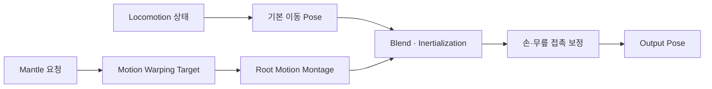

# 이동과 파쿠르

## 설계 의도

캡슐 이동과 메시 접촉 오차를 분리



## 이동

- 기본 Locomotion / Main States
- 기본 Pose 캐시: FinalBasePose
- Idle·Walk·Sprint 애니메이션 상세:

## 점프·낙하·회피

- JumpStart·Jumping·Falling 상태 표현
- 회피 애셋·전이 상세:

## Hanging

- 손·무릎 접촉: 애니메이션·IK에서 보정
- LedgeHanging → Fall Loop의 Blend Logic 확인
- Inertialization 사용 시 상태 머신 뒤에 Inertialization 노드 배치

## Mantle

- Root Motion Montage + Motion Warping
- 이동 목표: 시스템 설계에서 전달
- 손 접촉: IK·Control Rig
- 무릎 접촉: 애니메이션 수정
- 메시만 하강 후 복귀 시 Montage 구간·Root Motion Mode·Slot/Blend 중복 확인

## Vault

- 기능 구현 상태 유지
- 전용 애니메이션 미확보
- 점프와 구분되는 표현 확보 전 시각 완성 보류
- 최종 Vault Montage:

## 전체 실행 순서

```text
행동 상태 읽기 → 기본 Pose 선택
→ Mantle이면 Motion Warping Target 설정 → Root Motion Montage
→ Blend / Inertialization → 접촉 보정 → Output Pose
정상 종료 → Idle / Walk / Falling 상태 Pose
실패·취소 → Montage 중단 → 시스템 이동 상태 복구 → 해당 상태 Pose
```

## 문서 연결

- 기획: [이동과 파쿠르](../../02_%EA%B2%8C%EC%9E%84%20%EA%B8%B0%ED%9A%8D/%EC%8B%9C%EC%8A%A4%ED%85%9C%20%EA%B8%B0%ED%9A%8D/%EC%9D%B4%EB%8F%99%EA%B3%BC%20%ED%8C%8C%EC%BF%A0%EB%A5%B4.md)
- 시스템 설계: [이동과 파쿠르](../../03_%EC%8B%9C%EC%8A%A4%ED%85%9C%20%EC%84%A4%EA%B3%84/%EC%9D%B4%EB%8F%99%EA%B3%BC%20%ED%8C%8C%EC%BF%A0%EB%A5%B4.md)
- 애니메이션 설계: [이동과 파쿠르](%EC%9D%B4%EB%8F%99%EA%B3%BC%20%ED%8C%8C%EC%BF%A0%EB%A5%B4.md)
