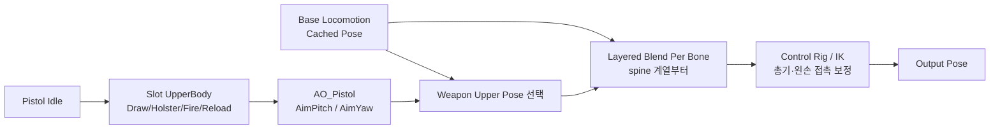

# 애니메이션과 조준

## 1. 현재 구성

주요 AnimBP:

`Content/Characters/Mannequins/Anims/Unarmed/ABP_Unarmed.uasset`

권총 애니메이션:

`Content/Astra/Entity/Animations/Pistol`

현재 구성 요소:

- 기본 Locomotion / Main States
- `FinalBasePose` Cached Pose
- Pistol Idle 상체 포즈
- `UpperBody` Montage Slot
- Layered Blend Per Bone
- `AO_Pistol` Aim Offset
- Control Rig

## 2. 권장 AnimGraph 순서



현재 권총 구성에서는 `UpperBody Slot → Aim Offset → Weapon Upper Pose 선택 → Layered Blend Per Bone` 순서를 사용합니다. Slot을 Aim Offset 뒤에 두면 Fire Montage가 고정된 팔·어깨 포즈로 돌아가 카메라 조준 Pitch를 무시하는 문제가 확인되었습니다. Draw/Holster처럼 Aim Offset이 필요 없는 구간은 Aim 입력을 0으로 보간하거나 해당 분기에서 적용을 끕니다. IK를 너무 앞에 두면 뒤의 Montage나 Blend가 손 위치를 다시 움직이므로 최종 접촉 보정은 가능한 한 뒤쪽에 둡니다.

## 3. UpperBody Slot

Slot은 Skeletal Mesh에서 Montage를 만드는 기능이 아닙니다.

1. Skeleton 에셋의 Anim Slot Manager에서 `UpperBody` Slot을 만듭니다.
2. Equip/Holster/Fire/Reload Montage의 Slot Track을 `DefaultGroup.UpperBody`로 변경합니다.
3. AnimBP AnimGraph에 `Slot 'UpperBody'` 노드를 추가합니다.
4. Slot 결과를 Layered Blend Per Bone의 상체 Blend Pose에 연결합니다.

Layered Blend Per Bone의 시작 뼈는 Skeleton에 맞는 `spine_01` 또는 상응하는 척추 뼈를 사용하고 Mesh Space Rotation Blend를 비교 테스트합니다.

## 4. Draw/Holster 연결

현재 Montage:

- `MM_Pistol_Equip_Montage`
- `MM_Pistol_Holster_Montage`

Holster는 역재생 설정을 DataAsset 코드에서 강제하지 않습니다. 별도 Holster Montage 에셋의 재생 방향과 구간을 에디터에서 설정하고 `WeaponDataAsset.HolsterMontage`에 연결합니다.

Pistol Idle과 Montage가 섞여 손이 어긋나는 경우:

- Montage Slot이 `UpperBody`인지 확인
- Montage Blend In/Out을 짧게 조정
- Holstering 중에는 지속 Pistol Idle 포즈의 적용 조건을 구분
- Attach Notify가 손이 실제로 무기를 놓는 프레임에 있는지 확인

현재는 Blend In/Out을 조정해 임시 해결했습니다. Equip 원본과 Pistol Idle의 첫 자세가 정확히 이어지지 않으므로 최종 품질은 호환 애니메이션으로 교체해야 합니다.
Fire와 Idle도 원본 포즈가 맞지 않아 Fire 후반 프레임으로 `MM_Pistol_NewIdle`을 만들었습니다. 현재 전환 포즈는 맞췄지만 새 Idle의 시작·끝 포즈가 달라 루프 경계가 끊기므로 근본 해결 항목으로 유지합니다.

## 5. Aim Pitch 계산

카메라와 캐릭터의 상대 회전을 사용합니다.

```text
DeltaRotation = NormalizedDeltaRotator(BaseAimRotation, ActorRotation)
TargetAimPitch = Clamp(DeltaRotation.Pitch, -70, 70)
AimPitch = FInterpTo(AimPitch, TargetAimPitch, DeltaTime, AimInterpSpeed)
```

AnimBP EventGraph에서 계산하되 `Character`가 유효한 경우에만 수행합니다. 비활성 상태에서는 `AimPitch`를 0으로 보간해 자연스럽게 복귀시킵니다.

## 6. Aim Offset

`AO_Pistol`은 입력 단위가 도(degree)입니다. 축 Min/Max가 `-1, 1`이면 마우스를 조금만 움직여도 끝 샘플로 즉시 이동해 뚝뚝 끊겨 보입니다.

현재 해결:

- Aim Offset 축 범위를 실제 샘플 각도에 맞게 확대
- Pitch 입력을 해당 범위의 도 단위로 전달
- EventGraph에서 `FInterpTo` 적용

카메라는 ±70도로 제한하되, 원본 Aim 샘플이 ±90도라면 Aim Offset 에셋의 축과 샘플 위치는 ±90도를 유지하고 **입력값만 ±70도로 Clamp**할 수 있습니다.

## 7. 카메라 Pitch 제한

PlayerCameraManager에서 다음을 설정합니다.

- `ViewPitchMin = -70`
- `ViewPitchMax = 70`

PlayerController가 커스텀 PlayerCameraManager 클래스를 사용한다면 그 클래스 기본값에서 설정합니다. 입력 축을 매 프레임 강제로 잘라내는 것보다 CameraManager의 View Pitch 제한을 우선합니다.
현재 비무장/권총 상태와 입력에서 Pitch Min/Max 적용을 확인했습니다.

## 8. 총기 방향 보정

Aim Offset은 상체가 대략 목표 방향을 보게 만드는 단계입니다. 총구를 실제 조준점에 정확히 맞추는 것은 별도의 정렬 단계입니다.

권장 순서:

1. 카메라 Ray로 AimTarget 계산
2. WeaponComponent에서 Muzzle → AimTarget 방향 계산
3. Aim Offset으로 척추·팔의 큰 방향 정렬
4. Control Rig 또는 IK로 오른손/무기 최종 보정
5. 발사체는 시각 포즈와 무관하게 Muzzle → AimTarget 방향 사용

시각 보정 각도를 무제한 적용하면 팔이 꺾이므로 최대 Pitch/Yaw 보정값을 DataAsset 또는 AnimBP 변수로 제한합니다.

## 9. 왼손 고정

권총의 왼손이 총에서 미끄러지는 것을 막기 위해 `LeftHandGrip` 소켓과 IK를 사용합니다.

### 에디터 작업

1. 권총 Static Mesh 에디터에서 `LeftHandGrip` Socket 생성
2. 권총을 오른손에 붙인 상태로 소켓 위치를 왼손 손바닥 중심에 맞춤
3. AnimBP에서 WeaponComponent의 소켓 World Transform을 가져옴
4. Mesh Component Space 또는 오른손 Bone Space로 변환
5. FABRIK/Two Bone IK의 Effector로 사용
6. Alpha는 Weapon Ready이고 `LeftHandGrip`이 유효할 때만 1
7. Draw/Holster 중에는 Alpha를 0 또는 Notify 기반 곡선으로 보간

오른손이 무기의 기준이므로 왼손 IK는 오른손/무기 보정 이후에 적용합니다.
현재 `LeftHandGrip`과 FABRIK 연결은 완료되었습니다. 손의 미세 이격과 상하 조준 시 비틀림, 위쪽 조준에서 왼팔이 머리를 통과하는 문제는 [[남은 이슈|남은 이슈]]에서 추적합니다.

## 10. 카메라 구성

현재 `CameraBoom(SpringArm) + FollowCamera(CameraComponent) + PlayerCameraManager` 구성이면 TPS에 충분합니다.

- SpringArm: 거리, 충돌, Lag
- CameraComponent: 실제 카메라와 FOV
- PlayerCameraManager: 최종 View, Pitch 제한, Camera Modifier, Shake

Unity Cinemachine과 정확히 같은 단일 컴포넌트는 없습니다. 역할상 PlayerCameraManager가 Cinemachine Brain에 가장 가깝고, SpringArm과 CameraComponent가 Virtual Camera의 일부 역할을 나눠 가집니다. Gameplay Cameras 플러그인은 더 모듈식이지만 현재 단계에서 교체할 필요가 없습니다.
