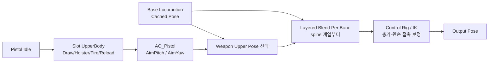

# 애니메이션과 조준

## 1. 현재 구성

주요 AnimBP:

`Content/Characters/Mannequins/Anims/Unarmed/ABP_Unarmed.uasset`

권총 애니메이션:

`Content/Astra/Entity/Animations/Pistol`

권총 행동 애니메이션은 Weapon Item의 소유물이 아니라 무기를 사용하는 Humanoid Entity의 표현입니다. 장기 콘텐츠 분류는 `Content/Astra/Entity/Humanoid/Animations`를 기준으로 하며, 현재 경로 이동은 참조 검증과 Redirector 정리를 거쳐 별도 수행합니다.

현재 구성 요소:

- 기본 Locomotion / Main States
- `FinalBasePose` Cached Pose
- Pistol Idle 상체 포즈
- `UpperBody` Montage Slot
- Layered Blend Per Bone
- `AO_Pistol` Aim Offset
- Control Rig

## 2. 권장 AnimGraph 순서



현재 권총 구성에서는 `UpperBody Slot → Aim Offset → Weapon Upper Pose 선택 → Layered Blend Per Bone` 순서를 사용합니다. Slot을 Aim Offset 뒤에 두면 Fire Montage가 고정된 팔·어깨 포즈로 돌아가 카메라 조준 Pitch를 무시하는 문제가 확인되었습니다. Draw/Holster처럼 Aim Offset이 필요 없는 구간은 Aim 입력을 0으로 보간하거나 해당 분기에서 적용을 끕니다. IK를 너무 앞에 두면 뒤의 Montage나 Blend가 손 위치를 다시 움직이므로 최종 접촉 보정은 가능한 한 뒤쪽에 둡니다.

## 3. UpperBody Slot

Slot은 Skeletal Mesh에서 Montage를 만드는 기능이 아닙니다.

1. Skeleton 에셋의 Anim Slot Manager에서 `UpperBody` Slot을 만듭니다.
2. Equip/Holster/Fire/Reload Montage의 Slot Track을 `DefaultGroup.UpperBody`로 변경합니다.
3. AnimBP AnimGraph에 `Slot 'UpperBody'` 노드를 추가합니다.
4. Slot 결과를 Layered Blend Per Bone의 상체 Blend Pose에 연결합니다.

Layered Blend Per Bone의 시작 뼈는 Skeleton에 맞는 `spine_01` 또는 상응하는 척추 뼈를 사용하고 Mesh Space Rotation Blend를 비교 테스트합니다.

## 4. Draw/Holster 연결

현재 Montage:

- `MM_Pistol_Equip_Montage`
- `MM_Pistol_Holster_Montage`

권총은 `EquipMontage = None`으로 두고 몸이 전투 방향에 정렬된 뒤 즉시 손에 부착하는 구성을 사용합니다. Draw 상태와 Pending Action은 유지하며, 다른 무기는 필요할 때 같은 구조에서 선택적으로 Equip Montage를 사용할 수 있습니다.

Holster는 역재생 설정을 DataAsset 코드에서 강제하지 않습니다. 별도 Holster Montage 에셋의 재생 방향과 구간을 에디터에서 설정하고 `WeaponDataAsset.HolsterMontage`에 연결합니다.

Pistol Idle과 Montage가 섞여 손이 어긋나는 경우:

- Montage Slot이 `UpperBody`인지 확인
- Montage Blend In/Out을 짧게 조정
- Holstering 중에는 지속 Pistol Idle 포즈의 적용 조건을 구분
- Attach Notify가 손이 실제로 무기를 놓는 프레임에 있는지 확인

현재는 Blend In/Out을 조정해 임시 해결했습니다. Equip 원본과 Pistol Idle의 첫 자세가 정확히 이어지지 않으므로 최종 품질은 호환 애니메이션으로 교체해야 합니다.
Fire와 Idle도 원본 포즈가 맞지 않아 Fire 후반 프레임으로 `MM_Pistol_NewIdle`을 만들었습니다. 현재 전환 포즈는 맞췄지만 새 Idle의 시작·끝 포즈가 달라 루프 경계가 끊기므로 근본 해결 항목으로 유지합니다.

## 5. Aim Pitch 계산

카메라와 캐릭터의 상대 회전을 사용합니다.

```text
DeltaRotation = NormalizedDeltaRotator(BaseAimRotation, ActorRotation)
TargetAimPitch = Clamp(DeltaRotation.Pitch, -70, 70)
AimPitch = FInterpTo(AimPitch, TargetAimPitch, DeltaTime, AimInterpSpeed)
```

AnimBP EventGraph에서 계산하되 `Character`가 유효한 경우에만 수행합니다. 비활성 상태에서는 `AimPitch`를 0으로 보간해 자연스럽게 복귀시킵니다.

## 6. Aim Offset

`AO_Pistol`은 입력 단위가 도(degree)입니다. 축 Min/Max가 `-1, 1`이면 마우스를 조금만 움직여도 끝 샘플로 즉시 이동해 뚝뚝 끊겨 보입니다.

현재 해결:

- Aim Offset 축 범위를 실제 샘플 각도에 맞게 확대
- Pitch 입력을 해당 범위의 도 단위로 전달
- EventGraph에서 `FInterpTo` 적용

카메라는 ±70도로 제한하되, 원본 Aim 샘플이 ±90도라면 Aim Offset 에셋의 축과 샘플 위치는 ±90도를 유지하고 **입력값만 ±70도로 Clamp**할 수 있습니다.

Center/Up/Down 샘플은 모두 `Mesh Space Additive`와 동일한 Base Pose를 사용해야 합니다. `Preview Base Pose`는 에디터 미리보기 설정이며 각 Animation Sequence의 Additive Base 설정을 대신하지 않습니다.

현재 Pitch 0에서는 양손이 맞지만 Pitch 절대값이 커질수록 왼손이 이탈합니다. FABRIK, Control Rig, 좌표계와 Layered Blend를 제거한 최소 구성에서도 반복되어 단순 IK 설정 문제로 확정하지 않습니다. 다음에는 각 샘플의 Skeleton·Retarget·Import 설정과 `hand_l relative to hand_r` 상대 Transform을 비교합니다.

## 7. 카메라 Pitch 제한

PlayerCameraManager에서 다음을 설정합니다.

- `ViewPitchMin = -70`
- `ViewPitchMax = 70`

PlayerController가 커스텀 PlayerCameraManager 클래스를 사용한다면 그 클래스 기본값에서 설정합니다. 입력 축을 매 프레임 강제로 잘라내는 것보다 CameraManager의 View Pitch 제한을 우선합니다.
현재 비무장/권총 상태와 입력에서 Pitch Min/Max 적용을 확인했습니다.

## 8. 총기 방향 보정

Aim Offset은 상체가 대략 목표 방향을 보게 만드는 단계입니다. 총구를 실제 조준점에 정확히 맞추는 것은 별도의 정렬 단계입니다.

권장 순서:

1. 카메라 Ray로 AimTarget 계산
2. WeaponComponent에서 Muzzle → AimTarget 방향 계산
3. Aim Offset으로 척추·팔의 큰 방향 정렬
4. Control Rig 또는 IK로 오른손/무기 최종 보정
5. 발사체는 시각 포즈와 무관하게 Muzzle → AimTarget 방향 사용

카메라-총구 수렴각과 실제 총열 보정량을 구분합니다. `DesiredMuzzleRotation - CameraDirectionRotation`은 Parallax 측정이고, Control Rig 입력은 `DesiredMuzzleRotation - CurrentMuzzleRotation`입니다.

유효 사거리 안에 Blocking Hit가 있을 때만 시각 보정을 활성화합니다. Hit가 없으면 논리적 발사 방향은 TraceEnd를 사용하지만 시각 총열 정렬은 끕니다. 현재 최대 Pitch/Yaw `30°` 설정으로 평사·상향·하향 조준을 검증했으며, 다른 무기나 초근접 자세에서 팔 꺾임이 확인될 때만 최소 정렬 거리 또는 무기별 최대값을 추가합니다. 자세한 측정값은 [[무기 조준·반동·명중률]]을 참고합니다.

현재 `MaxVisualAimCorrectionYaw/Pitch = 30°`에서 평상시와 상·하 조준의 실제 총열 방향이 발사 방향과 일치하는 것을 확인했습니다. 보정 해제 시 두 값은 0으로 복귀합니다. Fire Montage 중에는 반동 애니메이션 때문에 총열이 일시적으로 벗어나지만 탄환은 잠긴 Aim Solution 방향으로 정상 발사하며 Montage 종료 후 다시 일치하므로 정상 표현으로 봅니다.

## 9. 왼손 고정

AimOffset 왼손 이탈 문제는 완료되었습니다. 원인은 완성된 무기 애니메이션 위에 FABRIK을 추가하여 기존 손·팔 관계를 다시 보정한 것이었습니다. 완성된 애니메이션 경로에서는 중복 FABRIK을 제거하고, 절차적 왼손 고정이 필요한 별도 무기·상태에서만 FABRIK을 사용합니다.

### 에디터 작업

1. 권총 Static Mesh 에디터에서 `LeftHandGrip` Socket 생성
2. 권총을 오른손에 붙인 상태로 소켓 위치를 왼손 손바닥 중심에 맞춤
3. Aim Offset으로 큰 상체 방향을 먼저 구성
4. Control Rig에서 현재 Muzzle과 Desired Muzzle의 잔여 오차 계산
5. 오른손과 총열을 먼저 보정
6. 같은 Rig 평가 안에서 변경된 무기 위치의 LeftHandGrip을 기준으로 왼손 보정
7. Draw/Holster 중에는 보정을 끄거나 상태 기반으로 보간

오른손이 무기의 기준이므로 절차적 왼손 IK가 필요한 경우에는 오른손/무기 보정 이후에 적용합니다. 다만 완성된 무기 애니메이션에는 FABRIK을 중복 적용하지 않습니다. 향후 다른 무기에서 절차적 왼손 고정이 필요하면 해당 애니메이션 구성과 함께 별도로 검증합니다.

## 10. 카메라 구성

현재 `CameraBoom(SpringArm) + FollowCamera(CameraComponent) + PlayerCameraManager` 구성이면 TPS에 충분합니다.

- SpringArm: 거리, 충돌, Lag
- CameraComponent: 실제 카메라와 FOV
- PlayerCameraManager: 최종 View, Pitch 제한, Camera Modifier, Shake

Unity Cinemachine과 정확히 같은 단일 컴포넌트는 없습니다. 역할상 PlayerCameraManager가 Cinemachine Brain에 가장 가깝고, SpringArm과 CameraComponent가 Virtual Camera의 일부 역할을 나눠 가집니다. Gameplay Cameras 플러그인은 더 모듈식이지만 현재 단계에서 교체할 필요가 없습니다.

현재 Aim FOV는 `GA_WeaponAim → UAstraWeaponGameplayAbilityBase → EntityContext.PlayerCameraManager` 경로로 시작·종료하며, 실제 보간은 `AAstraPlayerCameraManager::UpdateCamera`가 담당합니다. 참조 등록 생명주기는 [[PlayerCameraManager 참조 구성]]을 참고합니다.

---

## 상위 페이지

- [[04_아트 및 애니메이션]]

## 관련

- [[무기 시스템]]
- [[무기 조준·반동·명중률]]
- [[게임 객체 분류]]
- [[로코모션과 파쿠르]]
