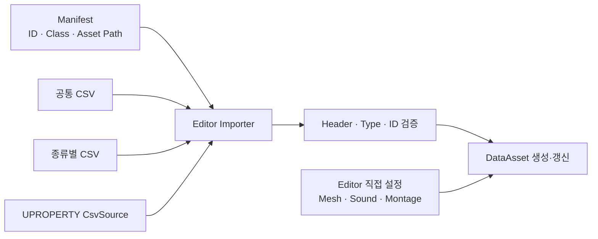

# CSV 기반 DataAsset 구성

## 설계 의도

대량 수치 편집과 Unreal 에셋 참조 편집 분리



## 식별자 분리

| 식별자 | 역할 |
|---|---|
| 정적 정의 ID | Manifest와 여러 CSV 행을 하나의 DataAsset으로 조립 |
| Runtime Instance ID | 현재 World에서 생성된 객체 식별 |
| Gameplay Tag | 분류·호환·행동 조건 표현 |
| Asset Path | Unreal 에셋 위치 |

정적 정의 ID에 `DA_`, `BP_` 같은 에셋 접두어를 넣지 않음

파일 경로와 논리 ID를 분리

## 구성 원칙

- 공통 속성은 공통 CSV
- 파생 종류의 속성은 종류별 CSV
- 모든 행은 같은 정적 정의 ID로 조인
- 수치·Bool·Enum은 CSV 관리에 적합
- Mesh·Texture·Montage·Sound·VFX·Class 참조는 DataAsset 직접 설정에 적합
- 한 Property의 관리 원본은 하나만 지정

## CsvSource Metadata

`UPROPERTY`의 `CsvSource` Metadata로 담당 CSV를 표시

Importer 검증:

1. CSV Header와 실제 Property 존재 확인
2. Property의 CsvSource와 입력 CSV 일치 확인
3. CsvSource 대상 Property의 Header 누락 확인
4. Manifest Class와 DataAsset 파생 타입 일치 확인
5. 필수 ID·Enum·범위 검사
6. 검증 성공 후 실제 Asset 적용

검증과 적용을 분리해 일부 행만 반영되는 상태 방지

## Property 이름 변경

DataAsset에 저장된 기존 값을 유지해야 하면 Core Redirect 추가

CSV Header도 새 Property 이름으로 함께 변경

```text
기존 Property → Core Redirect → 새 Property
기존 CSV Header → 새 CSV Header
Importer Header 검증 → DataAsset 적용
```

## Astra 적용

- 공통: Item, Equipment
- Weapon: 기본·Damage·Fire·Ammo·Continuous·Charge·Aim·Recoil·Accuracy
- Ammunition: 호환 탄종과 Projectile 실행 정적 데이터
- 별도 Projectile ID·CSV·DataAsset 없음
- 조립 키: `ItemID`
- 런타임 식별자: `RuntimeItemId`

현재 구현 상세: [장비와 인벤토리](../../../03_%EC%8B%9C%EC%8A%A4%ED%85%9C%20%EC%84%A4%EA%B3%84/%EC%9E%A5%EB%B9%84%EC%99%80%20%EC%9D%B8%EB%B2%A4%ED%86%A0%EB%A6%AC.md)

## 관련

- [Soft Reference와 비동기 로딩](Soft%20Reference%EC%99%80%20%EB%B9%84%EB%8F%99%EA%B8%B0%20%EB%A1%9C%EB%94%A9.md)
- [Unreal 지식 목록](../Unreal%20%EC%A7%80%EC%8B%9D%20%EB%AA%A9%EB%A1%9D.md)
- [Editor 작업 절차](../../Editor%20%EC%9E%91%EC%97%85%20%EC%A0%88%EC%B0%A8.md)
