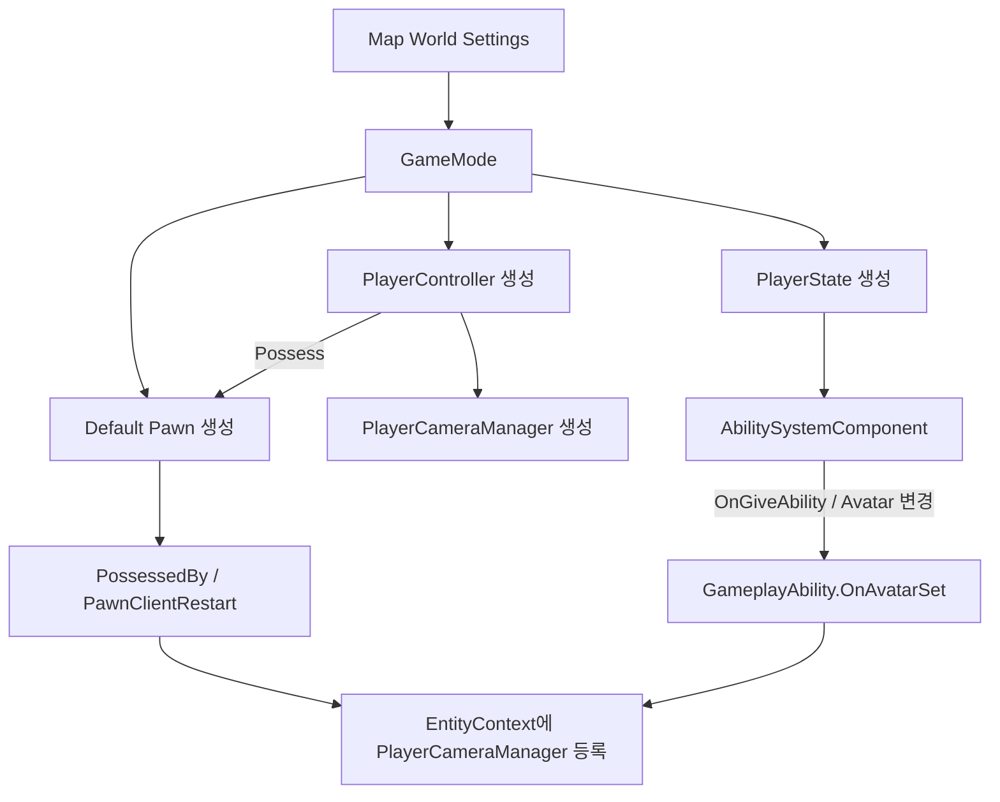

# PlayerCameraManager 참조 구성

## 설계 의도



## 핵심 이해

`GameMode`의 `Default Pawn Class`는 생성할 Pawn 클래스를 지정합니다. 실제 Pawn 생성과 Possess는 `AGameModeBase`와 `PlayerController`의 Gameplay Framework 생명주기가 수행합니다.

```text
HandleStartingNewPlayer
→ RestartPlayer
→ FindPlayerStart
→ RestartPlayerAtPlayerStart
→ SpawnDefaultPawnFor
→ PlayerController.Possess
```

`PlayerCameraManager`는 Pawn이 아니라 로컬 `PlayerController`가 관리합니다. Pawn 또는 Ability가 이를 사용해야 한다면 매번 Controller를 탐색하기보다 Possess 생명주기에서 프로젝트의 Context에 참조를 등록할 수 있습니다.

## 참조 등록 시점

- `PossessedBy`: Controller가 Pawn을 Possess한 서버 측 시점
- `OnRep_PlayerState`: PlayerState가 클라이언트에 복제된 시점
- `PawnClientRestart`: 로컬 Pawn 소유와 입력이 다시 구성되는 시점
- `UnPossessed`: 기존 Controller 참조를 제거해야 하는 시점

로컬 카메라 참조는 `PlayerController::IsLocalController()`를 확인한 뒤 등록합니다. 재소유·Avatar 교체를 고려해 초기 한 번만 등록한다고 가정하지 않습니다.

## Gameplay Ability의 OnAvatarSet

`OnAvatarSet`은 Ability가 생성될 때 스스로 호출하는 함수가 아닙니다. 호출 주체는 `UAbilitySystemComponent`입니다.

```text
AbilitySystemComponent.InitAbilityActorInfo
   OwnerActor = PlayerState
   AvatarActor = 현재 Pawn
→ GiveAbility 또는 Avatar 갱신
→ AbilitySystemComponent가 GameplayAbility.OnAvatarSet 호출
```

Ability 지급 시 Avatar가 이미 존재하면 인스턴스 생성 직후 호출된 것처럼 보일 수 있습니다. PlayerState의 ASC를 유지한 채 Pawn만 교체하면 기존 Ability 인스턴스에도 새 Avatar 기준으로 다시 호출될 수 있습니다.

## Astra 적용

```text
Map World Settings
→ GameMode Override = BP_GameMode
→ BP_PlayerController 생성
→ AstraPlayerState 생성
→ BP_PlayerCameraManager 생성
→ BP_PlayerCharacter 생성
→ BP_PlayerController.Possess(BP_PlayerCharacter)
→ PlayerCharacter.RefreshPlayerCameraManagerContext
→ EntityContext.PlayerCameraManager 저장
```

`UAstraWeaponGameplayAbilityBase::OnAvatarSet`은 `ActorInfo.AvatarActor`가 `IEntityContextProvider`를 구현하는지 확인하고 `UEntityContext`를 캐시합니다. 구체 `PlayerController`나 `PlayerCharacter`를 직접 캐스팅하지 않습니다.

```text
AbilitySystemComponent
→ UAstraWeaponGameplayAbilityBase.OnAvatarSet
→ AvatarActor.GetContext
→ CachedEntityContext
→ CachedEntityContext.PlayerCameraManager
→ StartAimFOV / StopAimFOV
```

## 설계상 주의점

- Context는 참조만 보관하고 FOV 계산이나 상태 판단을 수행하지 않습니다.
- Ability는 구체 Controller 구조가 아니라 Avatar가 제공하는 Context에 의존합니다.
- 실제 FOV 보간은 `PlayerCameraManager::UpdateCamera`가 담당합니다.
- `OnRemoveAbility`에서 캐시를 비웁니다.
- 새 맵에서 `GameMode Override`를 지정하지 않으면 프로젝트 기본 GameMode가 사용될 수 있으므로 World Settings를 확인합니다.

---

## 상위 페이지

- [Unreal 지식 목록](../Unreal%20%EC%A7%80%EC%8B%9D%20%EB%AA%A9%EB%A1%9D.md)
- [08_기술 위키_공통 가이드](../../08_%EA%B8%B0%EC%88%A0%20%EC%9C%84%ED%82%A4_%EA%B3%B5%ED%86%B5%20%EA%B0%80%EC%9D%B4%EB%93%9C.md)

## 관련

- [시스템 아키텍처](../../../03_%EC%8B%9C%EC%8A%A4%ED%85%9C%20%EC%84%A4%EA%B3%84/%EC%8B%9C%EC%8A%A4%ED%85%9C%20%EC%95%84%ED%82%A4%ED%85%8D%EC%B2%98.md)
- [무기 시스템](../../../03_%EC%8B%9C%EC%8A%A4%ED%85%9C%20%EC%84%A4%EA%B3%84/%EB%AC%B4%EA%B8%B0.md)
- [StateTree와 GAS](../../../03_%EC%8B%9C%EC%8A%A4%ED%85%9C%20%EC%84%A4%EA%B3%84/StateTree%EC%99%80%20GAS.md)
- [Entity Context](../StateTree/Entity%20Context.md)
