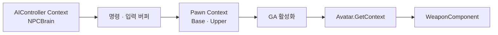

# NPC Context와 행동 연결 진단



## 설계 의도

두뇌 판단과 몸 실행의 연결 지점별 오류 진단

## Context 반환과 Blueprint 오버라이드

- 현상: GA의 GetEntityContext 반환값 null
- 확인 원인: NPC Blueprint의 GetContext 오버라이드 반환 핀 미연결
- 수정: 불필요한 오버라이드 삭제 후 C++ 부모 구현 상속
- 오버라이드 유지 시 EntityContext 변수를 Return Value에 연결
- GetEntityContext 호출 노드와 Avatar의 GetContext 구현 구분
- C++ 일반 호출 노드에 Call Parent Function 추가 불필요
- 결과: 2026-09-30 사용자 첫 발 정상 확인

```text
GA.GetEntityContext
→ CurrentActorInfo.AvatarActor
→ IEntityContextProvider.GetContext
→ Avatar Blueprint 오버라이드 또는 부모 C++ 구현
→ 해당 Pawn의 EntityContext 반환
```

## 두뇌와 몸의 Context

| 위치 | Context | Task 배치 |
|---|---|---|
| NPCBrain | AIController | NPC Idle Command, NPC Combat Attack, NPC Update Target Tracking |
| Base | Pawn·EntityContext | ChaseWalk, Patrol, DamageLook Blueprint Task |
| Upper | Pawn·EntityContext | Attack, Reload, Ready 공통 동작 Task |

- Could not find matching Context object: Task가 요구하는 타입과 트리 Context 확인
- NPC Idle Command를 Base Idle에 배치하면 AIController 바인딩 불일치
- NPCBrain Idle에 배치 후 두뇌 AIController 바인딩
- 몸 Task에서 필요한 Controller는 Enter마다 Pawn.GetController 또는 Actor.GetAIController로 확보
- Actor를 Controller로 직접 Cast하는 연결은 해당 Pawn의 Controller 조회가 아님
- 필수 Controller 누락은 구성 오류 로그·Task 실패. None을 성공으로 종료하지 않음

## 활성화 성공과 실제 발사

1. NPC ASC의 StartupAbilityClasses에 공격 GA 등록 확인
2. TryActivateAbilityByTag 반환값 확인. false면 실패 처리
3. WeaponComponent·CarryState·AimSolution.bValid 확인
4. Fire Montage의 Weapon_FireCommit과 공격 Commit 결과 확인
5. GA 종료 후 Upper Ready 복귀·ReadyEntered 확인

- Task 성공 표시는 실제 공격 성공과 별도
- Upper Attack Enter에서 GA 한 번 활성화. Tick은 종료 확인
- Ready Task: 손 부착 성공 후 ReadyEntered 게시·Running 유지
- 단발 반복은 두뇌 지속 Task에서 다음 공격 요청. 단발 입력 유지만으로 재발사하지 않음

## 입력·전이·시야

- 사거리 Condition의 AIController 바인딩 누락 시 Attack→Chase 전이 차단 가능
- Attack→Idle의 Has Target Memory는 Invert=true. false이면 타겟 기억 중 Idle·Attack 왕복
- ReadyEntered의 CancelSprint 중계는 Base Sprint 상태에서만 처리. Chase까지 끊는 Root 전이 제외
- CurrentTarget 존재와 현재 시야 확보 구분. 기억 중 Actor를 계속 볼 수 있는 것으로 처리하지 않음
- Chase Enter는 RequestChaseMove 한 번. Tick은 UpdateChaseMove. Exit은 CancelChaseMove
- 매 Tick Request 호출 시 진행 중 이동을 반복 취소할 수 있음
- NavMesh 투영 성공과 실제 도달 가능한 완전 경로 구분

## 탄약과 쿨다운

- NPC 재장전 설정: bIsNPC=true, bCanReload=true, bInfiniteReserveAmmo=true
- 예비 탄약 무제한과 탄창 무한은 별개. 발사 시 탄창 소비
- 사용자 확인: bCanReload 활성화 후 NPC 재장전 정상
- AttackCooldown은 무기 DA의 발사 간격. 요청 재시도 간격과 구분
- 취소·재발견 후 발사 간격이 사라지면 Cancel·Finish 경로의 Timer 제거 확인
- 쿨다운 시작·만료·무기 런타임 초기화와 공격 Sequence 수명 구분
- 2026-10-08: 취소 후 쿨다운 유지·CanAttackWeapon 검사 반영. 재빌드·재실행 후 발사 정상 사용자 확인
- 첫 발 차단 진단: astra.NPC.CombatDebug 1, NPCCombat Reason 로그 확인. 진단 종료 후 0

## 현재 연결 상태

- 순찰 C++ 반영. Blueprint 연결 진행
- Base Idle→Patrol의 Payload 조건 연결 확인
- Patrol Task Controller 확보·Patrol→ChaseWalk 전이는 추가 연결 대상
- HitReaction 상태 없음 사용자 확인. 피격 방향 Task·복귀 전이는 후속

## 전체 실행 순서

```text
NPCBrain Idle
→ NPC Idle Command(AIController 바인딩)
→ Patrol 명령 + Holster 요청
→ Base Idle의 Patrol Payload 검사
→ Patrol Enter
→ Pawn.GetController / Actor.GetAIController
→ Cast To AstraNPCAIController
   ├─ 실패 → 오류 로그 → FinishTask(false) → 실패 복구
   └─ 성공 → Controller 저장 → RequestIdlePatrol
              → Tick.UpdateIdlePatrol → 이동·도착 대기·다음 목적지

적 감지 → Chase 명령 → Patrol Exit.CancelIdlePatrol → ChaseWalk
취소 → CancelPatrol → Patrol Exit.CancelIdlePatrol → Idle
사망·상태 이탈 → Task Exit → 이동·Delegate·참조 정리
```

## 관련

- [NPC 행동 설계](../../../03_%EC%8B%9C%EC%8A%A4%ED%85%9C%20%EC%84%A4%EA%B3%84/NPC%20%ED%96%89%EB%8F%99.md)
- [NPC Idle 순찰·피격 방향 확인 연결](../../../07_QA_%ED%85%8C%EC%8A%A4%ED%8A%B8/NPC%20Idle%20%EC%88%9C%EC%B0%B0%C2%B7%ED%94%BC%EA%B2%A9%20%EB%B0%A9%ED%96%A5%20%ED%99%95%EC%9D%B8%20%EC%97%B0%EA%B2%B0.md)
- [Unreal 지식 목록](../Unreal%20%EC%A7%80%EC%8B%9D%20%EB%AA%A9%EB%A1%9D.md)
