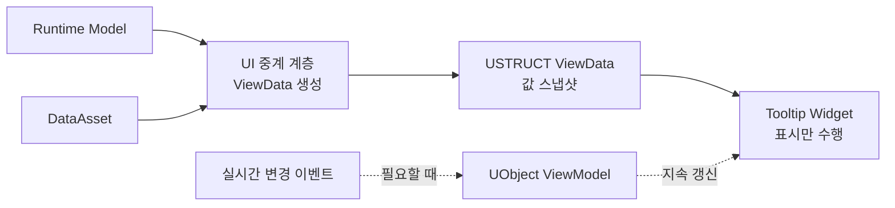

# Tooltip ViewData와 ViewModel

## 설계 의도

게임 객체 구조와 UI 표시 계약 분리



## ViewData 사용 기준

- 선택하거나 Hover할 때 한 번 표시
- 값 복사만 필요
- UI가 원본 객체를 수정하지 않음
- 수명이 짧고 소유권이 필요하지 않음

필드 수보다 데이터의 수명과 갱신 방식으로 결정

필드가 많아도 일회성 표시라면 `USTRUCT` 값 스냅샷이 적합

## ViewModel 사용 기준

- Tooltip을 연 상태에서 값이 계속 변함
- 여러 Widget이 같은 표시 상태 공유
- 이벤트 구독과 해제가 필요
- 비동기 로딩·상태 전환을 장기간 관리

이 조건이 생길 때 UObject ViewModel 검토

## 구조 확장

초기에는 하나의 ViewData로 시작

종류별 필드가 늘면 중첩 구조로 분리

```text
ItemTooltipViewData
├─ Common
├─ Equipment
├─ Weapon
└─ Ammunition
```

Widget이 원본 Model이나 DataAsset을 받아 Cast와 분기 반복 금지

중계 계층이 종류를 해석하고 표시 여부와 값을 모두 채움

## Blueprint 연결

`DisplayItemTooltip`은 ViewData만 입력으로 받음

Struct Pin을 변경하면 기존 Event Node의 핀이 남을 수 있으므로 Node 새로 고침 또는 재생성 후 Compile 필요

### 전체 실행 순서

```text
Inventory 또는 Gear Slot 선택
→ Slot Index 또는 Equipment Slot을 Menu Component에 전달
→ ItemInstance 조회
  ├─ 없음 → HideItemTooltip
  └─ 있음 → DataAsset과 Instance 값 읽기
            → 공통 ViewData 채우기
            → Equipment이면 장비 값 채우기
            → Weapon이면 무기 값 채우기
            → DisplayItemTooltip(ViewData)
              → Break ItemTooltipViewData
              → 종류별 Panel Visibility 설정
              → Text · Icon · 수치 설정

아이템 행동 성공·메뉴 닫기·선택 해제
→ HideItemTooltip
→ Tooltip Collapsed
```

## Astra 적용

현재 `FItemTooltipViewData`는 공통 Item, Equipment, Weapon 표시값을 포함

Ammunition 전용 표시값과 중첩 Struct 분리는 후속 확장

현재 구현 상세: [장비와 인벤토리](../../../03_%EC%8B%9C%EC%8A%A4%ED%85%9C%20%EC%84%A4%EA%B3%84/%EC%9E%A5%EB%B9%84%EC%99%80%20%EC%9D%B8%EB%B2%A4%ED%86%A0%EB%A6%AC.md)

## 관련

- [동적 위젯 생성과 데이터 갱신](%EB%8F%99%EC%A0%81%20%EC%9C%84%EC%A0%AF%20%EC%83%9D%EC%84%B1%EA%B3%BC%20%EB%8D%B0%EC%9D%B4%ED%84%B0%20%EA%B0%B1%EC%8B%A0.md)
- [팝업 위치와 화면 경계](%ED%8C%9D%EC%97%85%20%EC%9C%84%EC%B9%98%EC%99%80%20%ED%99%94%EB%A9%B4%20%EA%B2%BD%EA%B3%84.md)
- [Unreal 지식 목록](../Unreal%20%EC%A7%80%EC%8B%9D%20%EB%AA%A9%EB%A1%9D.md)
