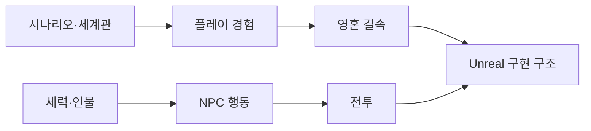

# Astra Overview

아스트라: 영혼결속의 프로젝트 문서 허브입니다.

## 핵심 콘셉트

- 장르: Unreal Engine 5.8 기반 TPS
- 무대: 영혼 에너지가 고갈되어 가는 행성 아말테아
- 핵심 능력: 아스트라와 영혼을 동기화하는 영혼 결속
- 장기 목표: 생존, 추방자 지원, 방주 재건, 발카의 지배 시스템 해체

## 기획 문서

- [[Scenario Structure]]
- [[World and Lore]]
- [[Characters]]
- [[NPC Behavior Design]]
- [[Combat Tendency]]
- [[Faction Relations]]
- [[SoulLink Design]]
- [[Survival Systems]]

## 구현 문서

- [[Project Architecture]]
- [[StateTree and GAS]]
- [[Locomotion]]
- [[Weapon System]]
- [[Animation and Aiming]]

## 문서 상태 규칙

- `확정`: 구현 또는 반복 확인을 통해 기준이 된 내용
- `기획`: Excel 기획안에 명시되었으나 구현 확인 전인 내용
- `검토 중`: 대안 또는 의문표가 남아 있는 내용
- `미정`: 자료에 값이 명시되지 않은 내용
- 설계 의도는 기존 Wiki, 일일 리포트, 기획 Excel 또는 대화에 근거가 있을 때만 작성합니다.

