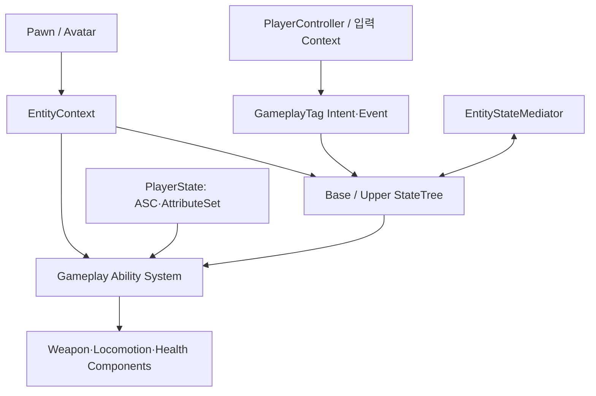

# Project Architecture

## 설계 의도

Unreal의 생명주기와 Possession을 따르면서 상태 선택, 행동 실행, 장기 데이터, 표현의 소유권을 분리한다. StateTree Task가 구체 PlayerCharacter를 직접 참조하지 않도록 EntityContext를 경계로 사용하고, Pawn 교체 후에도 유지할 상태는 PlayerState가 소유한다.

## 책임

| 책임 | 소유자 |
|---|---|
| 로컬 입력과 현재 Pawn 전달 | PlayerController |
| 짧은 행동 의도 | PlayerController 또는 입력 Context |
| 행동 상태 선택 | StateTree |
| 비용·쿨다운·실행·취소 | GAS |
| 장기 플레이어 Attribute·ASC | PlayerState |
| 컴포넌트 참조 제공 | EntityContext |
| StateTree 간 충돌 중재 | EntityStateMediator |
| 애니메이션 표현 | AnimBP·Montage·Aim Offset·Control Rig |

## 상세 기존 문서

- [[01-Architecture|기존 시스템 아키텍처]]
- [[02-Development-Rules|개발 규칙]]
- [[03-StateTree-and-GAS|StateTree와 GAS 상세]]
- [[04-Locomotion|로코모션]]
- [[05-Weapon-System|무기 시스템]]
- [[06-Animation-and-Aiming|애니메이션과 조준]]

## 관련 결정

- [[ADR-001 EntityContext를 참조 경계로 사용]]
- [[ADR-002 StateTree와 GAS 역할 분리]]
- [[ADR-003 PlayerState가 장기 ASC를 소유]]
- [[ADR-004 프로젝트 문서와 일반 지식 분리]]

