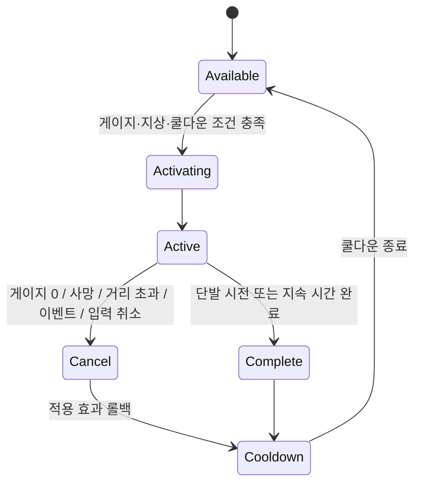

# SoulLink Design

## 설계 의도

소울링크를 하나의 거대한 분기 로직으로 만들지 않고, 타입별 메커니즘과 공통 생명주기(진입 조건, 비용, 취소, 롤백, 쿨다운)를 분리한다. 기존 구현 원칙에 따라 StateTree가 행동과 제어 흐름을 선택하고 GAS가 비용·쿨다운·실행·취소를 담당한다.

## 타입

| 타입 | 핵심 동작 | 비용 | 종료·취소 핵심 | 실행 책임 |
|---|---|---|---|---|
| Possession | 아스트라 직접 조종, 능력 강화 | 초당 지속 소모 | 게이지 0, 아스트라/플레이어 사망, 거리 초과, 컷신, 취소 | 제어권·카메라 전환, 거리 검사, 버프 롤백 |
| DirectSkill | 아스트라 단발 스킬 직접 사용 | 즉시 소모 | 시전 완료, 시전 중 피격/사망 | AI에 상태 전이 요청, 비용 차감, 쿨다운 시작 |
| Transform | 플레이어 모델과 기능을 아스트라 형태로 전환 | 초당 지속 소모 | 게이지 0, 플레이어 사망, 컷신, 취소 | 모델·AnimBP 변경, 변신 중 이동 제한, 해제 후 쿨다운 |
| Totem | 아스트라가 고정되어 범위 지원 | 즉시 소모 | 지속 시간, 사망, 선택적 넉백, 거리 초과 | 이동 정지, 지속 타이머, 일반 상태 복귀 |

## 공통 진입 조건

- 최소 요구 게이지 충족
- 플레이어가 지상에 있음
- DirectSkill·Transform·Totem은 쿨다운 중이 아님

## 구조 경계

- 입력 주체: [[Project Architecture|PlayerController 또는 입력 Context]]
- 행동 선택과 전이: [[StateTree and GAS|StateTree]]
- 비용·쿨다운·효과·취소: GAS Ability
- 지속 자원과 장기 쿨다운 소유: PlayerState의 ASC/AttributeSet
- Avatar/Pawn 교체: Possession 구조를 사용하고 장기 상태는 유지

## 미정

- 타입별 최소 게이지 수치: 
- 타입별 쿨다운 수치: 
- 거리 초과 기준: 
- Totem 넉백 취소 적용 여부: 
- Transform 중 이동 제한의 정확한 범위: 

## 관련

- [[NPC Behavior Design]]
- [[StateTree and GAS]]
- [[Project Architecture]]
- [[ADR-002 StateTree와 GAS 역할 분리]]

