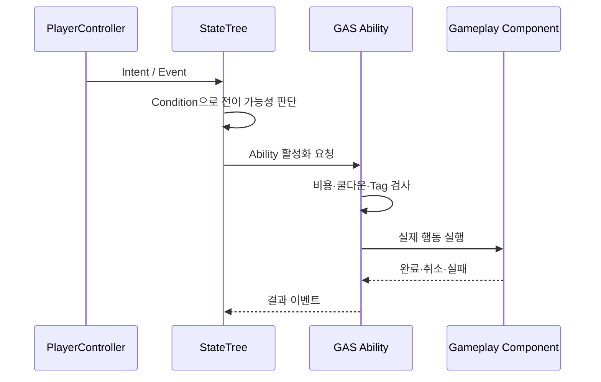

# StateTree and GAS

## 설계 의도

StateTree가 행동을 선택하고 GAS가 행동의 비용·쿨다운·실행·취소를 담당하게 해 AI와 플레이어가 같은 실행 Ability를 공유할 수 있게 한다. 상태 데이터가 커진 뒤 이전하지 않고 초기부터 ASC/Attribute 구조를 도입한다.

## 기준

- Base/Upper StateTree가 직접 참조로 결합하지 않고 Mediator와 Event를 사용한다.
- Condition은 전이 가능 여부, Task는 실제 진입·종료 작업을 담당한다.
- 지속 사실은 Attribute, GameplayTag, Component가 소유하고 StateTree는 선택에 사용한다.
- 구체 Gameplay Ability는 Blueprint 우선, C++은 공통 기반과 안전 검사를 담당한다.
- 상세 내용은 [[03-StateTree-and-GAS]]를 기준으로 한다.

## 관련

- [[Project Architecture]]
- [[SoulLink Design]]
- [[ADR-002 StateTree와 GAS 역할 분리]]

