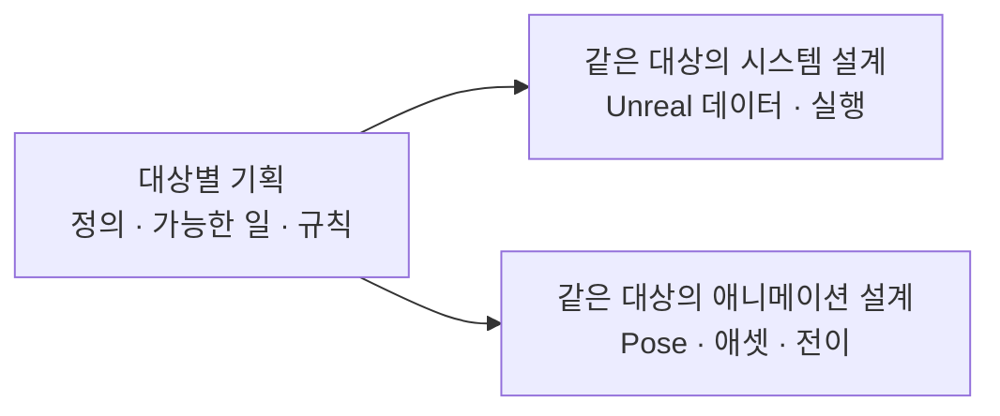

# 기획·설계 대응표

## 설계 의도

정의·행동과 구현 방법 분리

같은 대상을 기획·시스템 설계·애니메이션 설계로 연결

## 대응표

| 대상 | 게임 기획 | 시스템 설계 | 애니메이션 설계 |
|---|---|---|---|
| 게임 객체 분류 | [기획](02_%EA%B2%8C%EC%9E%84%20%EA%B8%B0%ED%9A%8D/%EA%B2%8C%EC%9E%84%20%EA%B0%9D%EC%B2%B4%20%EB%B6%84%EB%A5%98.md) | [시스템](03_%EC%8B%9C%EC%8A%A4%ED%85%9C%20%EC%84%A4%EA%B3%84/%EA%B2%8C%EC%9E%84%20%EA%B0%9D%EC%B2%B4%20%EB%B6%84%EB%A5%98.md) | [애니메이션](04_%EC%95%84%ED%8A%B8%20%EB%B0%8F%20%EC%95%A0%EB%8B%88%EB%A9%94%EC%9D%B4%EC%85%98/%EC%95%A0%EB%8B%88%EB%A9%94%EC%9D%B4%EC%85%98%20%EC%84%A4%EA%B3%84/%EA%B2%8C%EC%9E%84%20%EA%B0%9D%EC%B2%B4%20%EB%B6%84%EB%A5%98.md) |
| Entity | [기획](02_%EA%B2%8C%EC%9E%84%20%EA%B8%B0%ED%9A%8D/%EA%B0%9D%EC%B2%B4%20%EA%B8%B0%ED%9A%8D/Entity.md) | [시스템](03_%EC%8B%9C%EC%8A%A4%ED%85%9C%20%EC%84%A4%EA%B3%84/%EA%B0%9D%EC%B2%B4%20%EC%84%A4%EA%B3%84/Entity.md) | [애니메이션](04_%EC%95%84%ED%8A%B8%20%EB%B0%8F%20%EC%95%A0%EB%8B%88%EB%A9%94%EC%9D%B4%EC%85%98/%EC%95%A0%EB%8B%88%EB%A9%94%EC%9D%B4%EC%85%98%20%EC%84%A4%EA%B3%84/Entity.md) |
| 플레이어 | [기획](02_%EA%B2%8C%EC%9E%84%20%EA%B8%B0%ED%9A%8D/%EA%B0%9D%EC%B2%B4%20%EA%B8%B0%ED%9A%8D/%ED%94%8C%EB%A0%88%EC%9D%B4%EC%96%B4.md) | [시스템](03_%EC%8B%9C%EC%8A%A4%ED%85%9C%20%EC%84%A4%EA%B3%84/%EA%B0%9D%EC%B2%B4%20%EC%84%A4%EA%B3%84/%ED%94%8C%EB%A0%88%EC%9D%B4%EC%96%B4.md) | [애니메이션](04_%EC%95%84%ED%8A%B8%20%EB%B0%8F%20%EC%95%A0%EB%8B%88%EB%A9%94%EC%9D%B4%EC%85%98/%EC%95%A0%EB%8B%88%EB%A9%94%EC%9D%B4%EC%85%98%20%EC%84%A4%EA%B3%84/%ED%94%8C%EB%A0%88%EC%9D%B4%EC%96%B4.md) |
| Item | [기획](02_%EA%B2%8C%EC%9E%84%20%EA%B8%B0%ED%9A%8D/%EA%B0%9D%EC%B2%B4%20%EA%B8%B0%ED%9A%8D/Item.md) | [시스템](03_%EC%8B%9C%EC%8A%A4%ED%85%9C%20%EC%84%A4%EA%B3%84/%EA%B0%9D%EC%B2%B4%20%EC%84%A4%EA%B3%84/Item.md) | [애니메이션](04_%EC%95%84%ED%8A%B8%20%EB%B0%8F%20%EC%95%A0%EB%8B%88%EB%A9%94%EC%9D%B4%EC%85%98/%EC%95%A0%EB%8B%88%EB%A9%94%EC%9D%B4%EC%85%98%20%EC%84%A4%EA%B3%84/Item.md) |
| Prop | [기획](02_%EA%B2%8C%EC%9E%84%20%EA%B8%B0%ED%9A%8D/%EA%B0%9D%EC%B2%B4%20%EA%B8%B0%ED%9A%8D/Prop.md) | [시스템](03_%EC%8B%9C%EC%8A%A4%ED%85%9C%20%EC%84%A4%EA%B3%84/%EA%B0%9D%EC%B2%B4%20%EC%84%A4%EA%B3%84/Prop.md) | [애니메이션](04_%EC%95%84%ED%8A%B8%20%EB%B0%8F%20%EC%95%A0%EB%8B%88%EB%A9%94%EC%9D%B4%EC%85%98/%EC%95%A0%EB%8B%88%EB%A9%94%EC%9D%B4%EC%85%98%20%EC%84%A4%EA%B3%84/Prop.md) |
| 이동과 파쿠르 | [기획](02_%EA%B2%8C%EC%9E%84%20%EA%B8%B0%ED%9A%8D/%EC%8B%9C%EC%8A%A4%ED%85%9C%20%EA%B8%B0%ED%9A%8D/%EC%9D%B4%EB%8F%99%EA%B3%BC%20%ED%8C%8C%EC%BF%A0%EB%A5%B4.md) | [시스템](03_%EC%8B%9C%EC%8A%A4%ED%85%9C%20%EC%84%A4%EA%B3%84/%EC%9D%B4%EB%8F%99%EA%B3%BC%20%ED%8C%8C%EC%BF%A0%EB%A5%B4.md) | [애니메이션](04_%EC%95%84%ED%8A%B8%20%EB%B0%8F%20%EC%95%A0%EB%8B%88%EB%A9%94%EC%9D%B4%EC%85%98/%EC%95%A0%EB%8B%88%EB%A9%94%EC%9D%B4%EC%85%98%20%EC%84%A4%EA%B3%84/%EC%9D%B4%EB%8F%99%EA%B3%BC%20%ED%8C%8C%EC%BF%A0%EB%A5%B4.md) |
| 무기 | [기획](02_%EA%B2%8C%EC%9E%84%20%EA%B8%B0%ED%9A%8D/%EC%8B%9C%EC%8A%A4%ED%85%9C%20%EA%B8%B0%ED%9A%8D/%EB%AC%B4%EA%B8%B0.md) | [시스템](03_%EC%8B%9C%EC%8A%A4%ED%85%9C%20%EC%84%A4%EA%B3%84/%EB%AC%B4%EA%B8%B0.md) | [애니메이션](04_%EC%95%84%ED%8A%B8%20%EB%B0%8F%20%EC%95%A0%EB%8B%88%EB%A9%94%EC%9D%B4%EC%85%98/%EC%95%A0%EB%8B%88%EB%A9%94%EC%9D%B4%EC%85%98%20%EC%84%A4%EA%B3%84/%EB%AC%B4%EA%B8%B0.md) |
| 무기 조준·반동·명중률 | [기획](02_%EA%B2%8C%EC%9E%84%20%EA%B8%B0%ED%9A%8D/%EC%8B%9C%EC%8A%A4%ED%85%9C%20%EA%B8%B0%ED%9A%8D/%EB%AC%B4%EA%B8%B0%20%EC%A1%B0%EC%A4%80%C2%B7%EB%B0%98%EB%8F%99%C2%B7%EB%AA%85%EC%A4%91%EB%A5%A0.md) | [시스템](03_%EC%8B%9C%EC%8A%A4%ED%85%9C%20%EC%84%A4%EA%B3%84/%EB%AC%B4%EA%B8%B0%20%EC%A1%B0%EC%A4%80%C2%B7%EB%B0%98%EB%8F%99%C2%B7%EB%AA%85%EC%A4%91%EB%A5%A0.md) | [애니메이션](04_%EC%95%84%ED%8A%B8%20%EB%B0%8F%20%EC%95%A0%EB%8B%88%EB%A9%94%EC%9D%B4%EC%85%98/%EC%95%A0%EB%8B%88%EB%A9%94%EC%9D%B4%EC%85%98%20%EC%84%A4%EA%B3%84/%EB%AC%B4%EA%B8%B0%20%EC%A1%B0%EC%A4%80%C2%B7%EB%B0%98%EB%8F%99%C2%B7%EB%AA%85%EC%A4%91%EB%A5%A0.md) |
| 장비와 인벤토리 | [기획](02_%EA%B2%8C%EC%9E%84%20%EA%B8%B0%ED%9A%8D/%EC%8B%9C%EC%8A%A4%ED%85%9C%20%EA%B8%B0%ED%9A%8D/%EC%9E%A5%EB%B9%84%EC%99%80%20%EC%9D%B8%EB%B2%A4%ED%86%A0%EB%A6%AC.md) | [시스템](03_%EC%8B%9C%EC%8A%A4%ED%85%9C%20%EC%84%A4%EA%B3%84/%EC%9E%A5%EB%B9%84%EC%99%80%20%EC%9D%B8%EB%B2%A4%ED%86%A0%EB%A6%AC.md) | [애니메이션](04_%EC%95%84%ED%8A%B8%20%EB%B0%8F%20%EC%95%A0%EB%8B%88%EB%A9%94%EC%9D%B4%EC%85%98/%EC%95%A0%EB%8B%88%EB%A9%94%EC%9D%B4%EC%85%98%20%EC%84%A4%EA%B3%84/%EC%9E%A5%EB%B9%84%EC%99%80%20%EC%9D%B8%EB%B2%A4%ED%86%A0%EB%A6%AC.md) |
| 영혼 결속 | [기획](02_%EA%B2%8C%EC%9E%84%20%EA%B8%B0%ED%9A%8D/%EC%8B%9C%EC%8A%A4%ED%85%9C%20%EA%B8%B0%ED%9A%8D/%EC%98%81%ED%98%BC%20%EA%B2%B0%EC%86%8D.md) | [시스템](03_%EC%8B%9C%EC%8A%A4%ED%85%9C%20%EC%84%A4%EA%B3%84/%EC%98%81%ED%98%BC%20%EA%B2%B0%EC%86%8D.md) | [애니메이션](04_%EC%95%84%ED%8A%B8%20%EB%B0%8F%20%EC%95%A0%EB%8B%88%EB%A9%94%EC%9D%B4%EC%85%98/%EC%95%A0%EB%8B%88%EB%A9%94%EC%9D%B4%EC%85%98%20%EC%84%A4%EA%B3%84/%EC%98%81%ED%98%BC%20%EA%B2%B0%EC%86%8D.md) |
| 생존 시스템 | [기획](02_%EA%B2%8C%EC%9E%84%20%EA%B8%B0%ED%9A%8D/%EC%8B%9C%EC%8A%A4%ED%85%9C%20%EA%B8%B0%ED%9A%8D/%EC%83%9D%EC%A1%B4%20%EC%8B%9C%EC%8A%A4%ED%85%9C.md) | [시스템](03_%EC%8B%9C%EC%8A%A4%ED%85%9C%20%EC%84%A4%EA%B3%84/%EC%83%9D%EC%A1%B4%20%EC%8B%9C%EC%8A%A4%ED%85%9C.md) | [애니메이션](04_%EC%95%84%ED%8A%B8%20%EB%B0%8F%20%EC%95%A0%EB%8B%88%EB%A9%94%EC%9D%B4%EC%85%98/%EC%95%A0%EB%8B%88%EB%A9%94%EC%9D%B4%EC%85%98%20%EC%84%A4%EA%B3%84/%EC%83%9D%EC%A1%B4%20%EC%8B%9C%EC%8A%A4%ED%85%9C.md) |
| NPC 행동 | [기획](02_%EA%B2%8C%EC%9E%84%20%EA%B8%B0%ED%9A%8D/%EC%8B%9C%EC%8A%A4%ED%85%9C%20%EA%B8%B0%ED%9A%8D/NPC%20%ED%96%89%EB%8F%99.md) | [시스템](03_%EC%8B%9C%EC%8A%A4%ED%85%9C%20%EC%84%A4%EA%B3%84/NPC%20%ED%96%89%EB%8F%99.md) | [애니메이션](04_%EC%95%84%ED%8A%B8%20%EB%B0%8F%20%EC%95%A0%EB%8B%88%EB%A9%94%EC%9D%B4%EC%85%98/%EC%95%A0%EB%8B%88%EB%A9%94%EC%9D%B4%EC%85%98%20%EC%84%A4%EA%B3%84/NPC%20%ED%96%89%EB%8F%99.md) |
| NPC 전투 성향 | [기획](02_%EA%B2%8C%EC%9E%84%20%EA%B8%B0%ED%9A%8D/%EC%8B%9C%EC%8A%A4%ED%85%9C%20%EA%B8%B0%ED%9A%8D/NPC%20%EC%A0%84%ED%88%AC%20%EC%84%B1%ED%96%A5.md) | [시스템](03_%EC%8B%9C%EC%8A%A4%ED%85%9C%20%EC%84%A4%EA%B3%84/NPC%20%EC%A0%84%ED%88%AC%20%EC%84%B1%ED%96%A5.md) | [애니메이션](04_%EC%95%84%ED%8A%B8%20%EB%B0%8F%20%EC%95%A0%EB%8B%88%EB%A9%94%EC%9D%B4%EC%85%98/%EC%95%A0%EB%8B%88%EB%A9%94%EC%9D%B4%EC%85%98%20%EC%84%A4%EA%B3%84/NPC%20%EC%A0%84%ED%88%AC%20%EC%84%B1%ED%96%A5.md) |
| 팩션 관계 | [기획](02_%EA%B2%8C%EC%9E%84%20%EA%B8%B0%ED%9A%8D/%EC%8B%9C%EC%8A%A4%ED%85%9C%20%EA%B8%B0%ED%9A%8D/%ED%8C%A9%EC%85%98%20%EA%B4%80%EA%B3%84.md) | [시스템](03_%EC%8B%9C%EC%8A%A4%ED%85%9C%20%EC%84%A4%EA%B3%84/%ED%8C%A9%EC%85%98%20%EA%B4%80%EA%B3%84.md) | [애니메이션](04_%EC%95%84%ED%8A%B8%20%EB%B0%8F%20%EC%95%A0%EB%8B%88%EB%A9%94%EC%9D%B4%EC%85%98/%EC%95%A0%EB%8B%88%EB%A9%94%EC%9D%B4%EC%85%98%20%EC%84%A4%EA%B3%84/%ED%8C%A9%EC%85%98%20%EA%B4%80%EA%B3%84.md) |
| 세계관과 설정 | [기획](02_%EA%B2%8C%EC%9E%84%20%EA%B8%B0%ED%9A%8D/%EC%84%B8%EA%B3%84%EA%B4%80/%EC%84%B8%EA%B3%84%EA%B4%80%EA%B3%BC%20%EC%84%A4%EC%A0%95.md) | [시스템](03_%EC%8B%9C%EC%8A%A4%ED%85%9C%20%EC%84%A4%EA%B3%84/%EC%84%B8%EA%B3%84%EA%B4%80%EA%B3%BC%20%EC%84%A4%EC%A0%95.md) | [애니메이션](04_%EC%95%84%ED%8A%B8%20%EB%B0%8F%20%EC%95%A0%EB%8B%88%EB%A9%94%EC%9D%B4%EC%85%98/%EC%95%A0%EB%8B%88%EB%A9%94%EC%9D%B4%EC%85%98%20%EC%84%A4%EA%B3%84/%EC%84%B8%EA%B3%84%EA%B4%80%EA%B3%BC%20%EC%84%A4%EC%A0%95.md) |
| 시나리오 구조 | [기획](02_%EA%B2%8C%EC%9E%84%20%EA%B8%B0%ED%9A%8D/%EC%8B%9C%EB%82%98%EB%A6%AC%EC%98%A4/%EC%8B%9C%EB%82%98%EB%A6%AC%EC%98%A4%20%EA%B5%AC%EC%A1%B0.md) | [시스템](03_%EC%8B%9C%EC%8A%A4%ED%85%9C%20%EC%84%A4%EA%B3%84/%EC%8B%9C%EB%82%98%EB%A6%AC%EC%98%A4%20%EA%B5%AC%EC%A1%B0.md) | [애니메이션](04_%EC%95%84%ED%8A%B8%20%EB%B0%8F%20%EC%95%A0%EB%8B%88%EB%A9%94%EC%9D%B4%EC%85%98/%EC%95%A0%EB%8B%88%EB%A9%94%EC%9D%B4%EC%85%98%20%EC%84%A4%EA%B3%84/%EC%8B%9C%EB%82%98%EB%A6%AC%EC%98%A4%20%EA%B5%AC%EC%A1%B0.md) |
| 주요 인물 | [기획](02_%EA%B2%8C%EC%9E%84%20%EA%B8%B0%ED%9A%8D/%EC%BA%90%EB%A6%AD%ED%84%B0/%EC%A3%BC%EC%9A%94%20%EC%9D%B8%EB%AC%BC.md) | [시스템](03_%EC%8B%9C%EC%8A%A4%ED%85%9C%20%EC%84%A4%EA%B3%84/%EC%A3%BC%EC%9A%94%20%EC%9D%B8%EB%AC%BC.md) | [애니메이션](04_%EC%95%84%ED%8A%B8%20%EB%B0%8F%20%EC%95%A0%EB%8B%88%EB%A9%94%EC%9D%B4%EC%85%98/%EC%95%A0%EB%8B%88%EB%A9%94%EC%9D%B4%EC%85%98%20%EC%84%A4%EA%B3%84/%EC%A3%BC%EC%9A%94%20%EC%9D%B8%EB%AC%BC.md) |

## 작성 규칙

- 대상별 대표 문서 1:1 대응
- 같은 대상의 제목·행동명 통일
- 상세 문서: 대표 문서 아래 연결
- 공통 구현 문서: 아키텍처·StateTree/GAS·작업 규칙·ADR
- 모든 기획·설계 문서에 의도 항목 포함
- 기획 문서: `기획 의도`
- 시스템·애니메이션 설계 문서: `설계 의도`
- 근거 없는 의도·구현 방법·수치: 빈칸
- 문체: 단문형 정의·사용·분리·유지 등 명사형 종결
- 원문 인용: 의미 손실 방지를 위해 원문 어투 보존
- Markdown: 이후 수정 기준
- 엑셀: 최초 기획의 참고 원본
- 기존 최신 확정 사항 우선 원문과 차이는 별도 표시
- Markdown의 최상위 제목 유지

## 참고 원본

- [시나리오](../%EC%9B%90%EB%B3%B8%20%EB%AC%B8%EC%84%9C/%EC%8B%9C%EB%82%98%EB%A6%AC%EC%98%A4.xlsx)
- [NPC 행동 설계](../%EC%9B%90%EB%B3%B8%20%EB%AC%B8%EC%84%9C/NPC%20%ED%96%89%EB%8F%99%20%EC%84%A4%EA%B3%84.xlsx)
- [원문 대응표](../%EC%9B%90%EB%B3%B8%20%EB%AC%B8%EC%84%9C/%EC%9B%90%EB%AC%B8%20%EB%8C%80%EC%9D%91%ED%91%9C.md)
